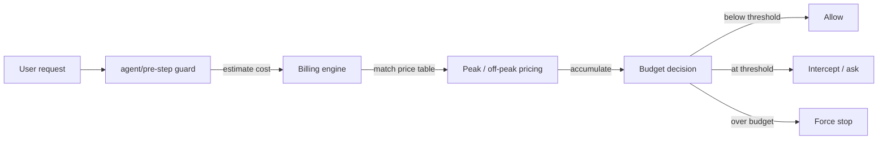

<div align="center">

<a id="dsh-budget-guard-plugin"></a>

# 🏦 dsh-budget-guard-plugin

**Draw a budget line across every task in DSH. Real-time accounting, auto-interception, and downgraded estimates.**

<strong>English</strong> · <a href="./README.md">简体中文</a>

[](https://www.npmjs.com/package/dsh-budget-guard-plugin)
[](https://www.npmjs.com/package/dsh-budget-guard-plugin)
[](https://github.com/Existence001100/dsh-budget-guard-plugin/actions/workflows/ci.yml)
[](./LICENSE)
[](https://nodejs.org/)
[](https://awesome-dsh-plugin.com)

</div>

Draws a budget line across every task in DSH (DeepSeek Harness): cap consumption by **CNY amount** or **token count**, warn as you approach the ceiling, and at the threshold either abort automatically (`auto`) or ask you to "continue / abort" (`manual`). After **every turn** it also estimates how many steps and how much money are left.

**🚀 Quick install**

```sh
dsh plugin --profile web add dsh-budget-guard-plugin
```

Restart the Web profile after installation. Full steps (GitHub install, update/remove, local development) are in [Quick Start](#quick-start).

[🚀 Quick Start](#quick-start) · [✨ Capabilities](#what-it-does) · [⚙️ Configuration](#configuration) · [🐛 Feedback](https://github.com/Existence001100/dsh-budget-guard/issues)

## Table of contents

- [What it does](#what-it-does)
- [Enforcement flow](#enforcement-flow)
- [Quick Start](#quick-start)
- [Compatibility](#compatibility)
- [Setting a budget](#setting-a-budget)
- [Configuration](#configuration)
- [Peak / off-peak pricing](#peak--off-peak-pricing)
- [How to reconcile amounts (when it doesn't match the official bill)](#how-to-reconcile-amounts-when-it-doesnt-match-the-official-bill)
- [Cold start and snapshots](#cold-start-and-snapshots)
- [Unknown models / unknown prices](#unknown-models--unknown-prices)
- [Parent task / subagent aggregation](#parent-task--subagent-aggregation)
- [Retries / period attribution](#retries--period-attribution)
- [Manual mode: temporary grant vs. silencing the prompt](#manual-mode-temporary-grant-vs-silencing-the-prompt)
- [HTTP routes](#http-routes)
- [Read-only fields](#read-only-fields)
- [How the per-turn estimate works (no extra tokens)](#how-the-per-turn-estimate-works-no-extra-tokens)
- [UI](#ui)
- [Interception details](#interception-details)
- [Zero dependencies and Config projection](#zero-dependencies-and-config-projection)
- [Build and test](#build-and-test)
- [Known limitations](#known-limitations)
- [License](#license)

## What it does

| Icon | Capability | How it works |
| --- | --- | --- |
| 🚦 | Budget declaration | Plugin Config (global default) or the `/budget` command in a conversation (current session only) |
| 💸 | Live accounting | Accumulates input/output/cache tokens from `assistant/message.usage` in the session log; every message is billed at the Beijing peak/off-peak price **in effect at the moment it actually occurred** |
| 🛑 | Automatic interception | Calls `agent.cancel({ kind: 'hook' })` from `agent/turn-stopping` once `interceptRatio` is reached; `agent/pre-step` rejects the next step when the budget is exceeded, so no further model calls are made |
| ✋ | Manual interception | `manual` mode only warns and never cancels; the budget bar under the composer offers "Continue / Abort" buttons |
| ⚠️ | Warning | At `warnRatio` (default 80%) a prominent notice appears on the budget bar and the per-turn card |
| 📐 | Pre-task rough estimate | Before the first turn, shows a range of 3–12 steps with a cost/token range and share of budget (can be disabled) |
| 📊 | Downgraded estimate | Shows only the **recent burn rate** (average consumption over the last 3 turns/steps). Remaining steps and remaining cost appear only when the model itself states a plan; **future total spend is never predicted**; no extra LLM call is made |
| 🧭 | Output location | `estimateOutput`: `chat` (per-turn card), `sidebar` (persistent page in the right sidebar), `both` (default). The sidebar page comes from `dsh-better-sidebar`; without that bundle it falls back to the card |
| ✅ | Config validation | Enum values, numeric ranges and unknown keys are validated at plugin load; invalid values raise `ValidationError` |
| 🛡️ | Guardrails | `/config/save` and `/action` accept loopback requests only by default; cold-start snapshots plus replay from the session log keep the ledger recoverable and never billed twice |

## Enforcement flow



Each `assistant/message` is priced one by one using its own `event.time` and then summed; the decision uses two independent budget lines (amount and tokens), and **whichever is hit first wins** — a dimension set to 0 takes no part.

## Quick Start

### Requirements

- DeepSeek Harness `0.2.x` or later;
- Node.js `>=22.13`;
- pnpm available on `PATH` for `dsh plugin`.

### Install from npm (recommended)

```sh
dsh plugin --profile web add dsh-budget-guard-plugin
```

DSH recognizes the package's `dsh.bundle` manifest and adds `dsh-budget-guard-plugin` to the Web profile automatically. Restart a running Web profile after installation.

After installation the bundle inserts one `budget-guard` row with this default config:

```yaml
- insert:
    - id: budget-guard
      name: 'dsh-budget-guard-plugin'
      config:
        interceptMode: auto
        enableTurnEstimate: true
        estimateOutput: both
```

`package.json` already declares `dsh.bundle.patch`, `exports["./client"]`, `locale/*.json` and `icon`, and its `files` field includes `lib/` and `cordis.patch.yml`, so the published npm package is also recognised by `dsh plugin`.

### Install from GitHub

```sh
dsh plugin --profile web add github:Existence001100/dsh-budget-guard-plugin
```

Use the GitHub source when testing unreleased changes from `main`. Pin a commit when reproducibility matters.

### Update or remove

```sh
dsh plugin --profile web update dsh-budget-guard-plugin
dsh plugin --profile web remove dsh-budget-guard-plugin
```

Restart the profile after either operation so its composition matches the installed bundle set.

### Install a local checkout for development

```sh
git clone https://github.com/Existence001100/dsh-budget-guard-plugin.git
cd dsh-budget-guard-plugin
pnpm install --frozen-lockfile
node build.mjs
dsh plugin --profile web add .
```

The included `cordis.patch.yml` inserts `budget-guard` into the host composition for all sessions.

## Compatibility

| Component | Supported or continuously verified |
| --- | --- |
| DeepSeek Harness | `0.2.0` or later. We continuously track DSH host API changes. |
| Node.js | `>=22.13` |
| pnpm | Latest version, used with `dsh plugin` |
| Operating systems | Windows / macOS / Linux |

This plugin is built on official DSH extension points (`agent/turn-stopping`, `agent/pre-step`, etc.) without modifying the core model logic. If you find an interface incompatibility in a specific DSH version, please open an [issue](https://github.com/Existence001100/dsh-budget-guard/issues).

## Setting a budget

### Option 1: conversation command (recommended, current session only)

```text
/budget 2.5              # ¥2.50 for this task
/budget 20000 tokens     # 20k tokens for this task
/budget 20k              # same as above
/budget both 2 20000     # both amount and token caps (whichever is hit first wins)
/budget                  # show current budget, usage, progress and the last per-turn estimate
/budget continue         # manual mode: continue, raising the budget by ~10% before prompting again
/budget abort            # manual mode: abort the current turn
/budget unlock           # lift budget interception for this session (cost is still tracked, but nothing aborts or blocks)
/budget lock             # restore budget interception for this session
/budget off              # clear the session override and fall back to the Config default (restores interception too)
/budget reset-snapshot   # drop this session's cache and snapshot entry and re-bill from the session log (for troubleshooting)
```

**A budget of 0 (unset) never blocks anything.** `budgetAmount` and `tokenBudget` both default to `0`, meaning "this line does not exist": no turn is cancelled, `pre-step` does not reject, and no "continue?" prompt appears. Threshold checks are enabled only when the amount or the token budget is > 0. Being blocked although you never set a budget is a bug, not a design decision — a regression test pins this down (spending hundreds of thousands of tokens must neither cancel nor reject).

`/budget reset-snapshot` exists for the "settlement rejected because the detail could not be rolled back" case:

- **What it clears**: this session's billing cache (`cost`, `stepCharges`, `settledCharges`, settlement watermark, `blockedSettlements`) is rebuilt from scratch.
- **What it keeps**: manual decisions such as "continue / don't ask again" and the budget declared via `/budget` — those are user choices, not ledger entries.
- **One-shot operation**: no "replayable effect" is written. On restart, the `command/run` entry in the log is recognised as a side-effect-free argument, so the cache is **not** cleared again on every restart.
- **Multi-instance boundary**: the reset immediately recomputes from the log and writes a snapshot with an updated timestamp (a tombstone); for a given session the entry with the newest `savedAt` in the directory wins, so another instance's stale cache is never read back. If another instance writes fresh state *after* the reset, that newer state wins (it is its own, further-folded view of the log).
- **After the reset**: the next read is the genuine recomputed state — no brief `loading` flash and no zero-then-jump; if the log really does record spend, the recomputation matches the log.

The command never calls the model; it only writes a `command/run` / `command/done` log entry, and after a restart the plugin replays that budget declaration from `command/run`.

### Option 2: budget bar under the input box (current session only)

Only one line is shown under the input box: `No budget · ¥0.00 used` (or `Budget ¥2.00 · ¥1.15 used` when a budget exists). Clicking it expands:

- Cost breakdown: input (miss) / cache hit / output, peak and off-peak prices, latest model, current period, tokens, and an unknown-model notice;
- A "Set budget for this task…" button: expands amount and token inputs; saving writes through the same `/budget` command into the session log, so it is replayable and auditable.

### Option 3: Config defaults / settings page

Override this row in the profile's `cordis.patch.yml`, or open **Settings → Budget Guard**. The settings page exposes the **commonly used** knobs (21 of them), each with a one-line description:

| Group | Adjustable |
| --- | --- |
| Interception | Intercept mode (auto / manual toggle), warn ratio, intercept threshold, unknown-model warning, cumulative grant ceiling, manual hard-stop multiplier, hard interception before each step |
| Per-turn estimate | Per-turn estimate toggle, output location (chat card / right sidebar / both), minimum estimate interval, pre-task rough estimate toggle |
| Default budget | Default amount, default tokens, currency |
| Snapshot | Cold-start snapshot toggle, sessions kept, days kept for inactive sessions, detail turns kept, per-session settlement record cap (`snapshotPath` is not here; see below) |
| Access | Local-only settings changes (`requireLocalControl`), local-only actions on the current turn (`requireLocalAction`) |

**4 keys are not in the form** and can only be edited by hand in `cordis.patch.yml`: `snapshotPath` (free-form path), `allowedOrigins` (array), `holidays` (array of dates) and `useBuiltinHolidays` (toggle tied to `holidays`). Tests assert that "form keys + these 4 == every key in `DEFAULTS`", so forgetting a control when adding a Config key fails the tests immediately.

Ratio fields are entered as percentages (`85` means `0.85`). The footer shows the price source, holiday source, cross-origin allowlist size, and whether the right sidebar is available.

"Save all settings" posts to `POST /dsh-budget/config/save`: the Host merges the patch into the current Config and revalidates the whole thing with **exactly the same validator the plugin uses at load**, so cross-field rules (`warnRatio ≤ interceptRatio`, grant ceiling must stay below the hard-stop line) are rejected right there with a specific reason; unknown keys are a 400. It writes back the `config` of the current bundle row, which is equivalent to editing `cordis.patch.yml` by hand.

> Fixed in 0.3.10: the settings page used to divide an already-fractional `warnRatio: 0.8` by 100 (yielding `0.008`), so every "save all settings" was rejected by the Host with `warnRatio must be ... between 0.01 and 1`. It now submits `0.8 / 0.95 / 0.2` unchanged.

```yaml
- id: budget-guard
  config:
    budgetAmount: 2
    tokenBudget: 0
    currency: CNY
    warnRatio: 0.8
    interceptRatio: 0.95
    interceptMode: auto
    enablePreEstimate: true
    enableTurnEstimate: true
    estimateOutput: both
    turnEstimateMinInterval: 1500
    enforceAtPreStep: true
    holidays: []
```

> Amount and tokens are two independent budget lines; when both are configured, **either one** reaching its threshold triggers interception. A dimension set to 0 does not take part.

## Configuration

| Key | Default | Description |
| --- | --- | --- |
| `budgetAmount` | `0` | Default amount budget per session; `0` means no amount cap |
| `tokenBudget` | `0` | Default token budget per session; `0` means no token cap |
| `currency` | `CNY` | Only `CNY` / `RMB` are accepted; both mean RMB and are displayed as `¥` (no FX conversion) |
| `warnRatio` | `0.8` | Warn ratio; must be ≤ `interceptRatio` |
| `interceptRatio` | `0.95` | Intercept threshold (0.01–1) |
| `interceptMode` | `auto` | `auto`: cancel automatically; `manual`: warn only and wait for the user to click "Continue / Abort" |
| `enablePreEstimate` | `true` | Show a rough estimate before the task starts |
| `enableTurnEstimate` | `true` | Show a consumption estimate after every turn: recent historical average only when no plan is given, never extrapolated into the future |
| `estimateOutput` | `both` | `chat` / `sidebar` / `both` |
| `turnEstimateMinInterval` | `1500` | Minimum interval between two estimates (ms), to avoid repeated work on very fast turns |
| `enforceAtPreStep` | `true` | Also hard-block at `agent/pre-step`, so an over-budget task cannot keep buying model calls |
| `holidays` | `[]` | Public holidays (`YYYY-MM-DD`). When non-empty it **fully replaces** the built-in table; when empty / entirely invalid and `useBuiltinHolidays=true`, the built-in table is used |
| `useBuiltinHolidays` | `true` | Whether to fall back to the built-in 2024–2026 holiday table when `holidays` is empty; `false` plus empty means "no holidays"; warns once the built-in table is out of range (2027 onwards) |
| `allowedOrigins` | `[]` | Development-only cross-origin allowlist; production allows same-origin only, see "HTTP routes" |
| `enableSnapshot` | `true` | Persist accumulated state into the cold-start snapshot |
| `snapshotPath` | `''` | Snapshot base path; when empty, `$DSH_HOME/budget-guard/snapshots.json` is used and the real file is `<stem>.<pid>.json` |
| `snapshotMaxSessions` | `200` | Maximum number of sessions kept per instance snapshot; active sessions are kept first |
| `snapshotKeepTurns` | `8` | How many recent turns keep their full `stepCharges` detail; retries of older steps are rejected with a warning instead of being added twice |
| `snapshotMaxAgeDays` | `30` | Maximum age of inactive snapshots; `0` disables age-based cleanup |
| `unknownWarnRatio` | `0.2` | When the share of unpriced tokens reaches this value, warn that "estimated at the highest price, actual cost may be lower" |
| `maxGrantedPercent` | `30` | Maximum cumulative grant from manual "Continue"; the default final value is 130%, strictly below the 142.5% hard-stop line |
| `manualHardStopRatio` | `1.5` | In manual mode (including suppress) force an abort once `interceptRatio × this value` is exceeded |
| `perSessionMaxSettled` | `2000` | How many settled summaries are kept per session; beyond that, new steps only get a marker, and retries are rejected rather than replaced |
| `requireLocalControl` | `true` | `/config/save` (changing global budget) accepts loopback requests only; changing budgets from a remote GUI requires turning this off |
| `requireLocalAction` | `true` | `/action` (continue / abort / set budget for this task) accepts loopback requests only; can be disabled separately to allow remote manual actions |

Unit prices affect only the **amount** accounting; token budgets always use the real usage. Prices are not hard-coded in Config — see the next section.

`GET /dsh-budget/config` also returns 4 **read-only** fields (`output` / `holidaysSource` / `priceSources` / `server`) that cannot be written back through `/config/save`; see the "Read-only fields" subsection under "HTTP routes".

## Peak / off-peak pricing

- The time zone is fixed to `Asia/Shanghai` (UTC+08:00, no DST); Beijing time is derived from a fixed offset, with no time zone library.
- **Peak**: Monday to Friday, `09:00–12:00` and `14:00–18:00` (half-open intervals); all other times, Saturdays, Sundays and any date in `holidays` are off-peak all day.
- The period is decided from **each `assistant/message`'s `event.time`**, not from the clock at render time; a session that crosses peak and off-peak is priced message by message and then summed.
- Price unit: **CNY per million tokens**, structured as:

```json
{
  "models": {
    "deepseek-flash": {
      "peak":    { "input_miss": 2, "input_hit": 0.04, "output": 8 },
      "offpeak": { "input_miss": 1, "input_hit": 0.02, "output": 4 }
    }
  }
}
```

> Corrected in 0.4.0: `output` is back to the official list price of **`8` (peak) and `4` (off-peak, 50%)**; input miss `2 / 1`, cache hit `0.04 / 0.02` (after DeepSeek's official price adjustment). The separate cache-write line item was also removed: cache-write tokens are already part of `input_miss` and are billed at the miss price.

- Precedence: built-in defaults → [prices/official-prices.json](prices/official-prices.json) → `prices/local-prices.json`. Copy [prices/local-prices.example.json](prices/local-prices.example.json) to `prices/local-prices.json` to override any field.
- The `official-prices.json` in this repository contains **conservative sample values** (the plugin never fetches prices from the network); before going live, override them with the official unit prices on your actual bill via `local-prices.json`. After editing a price file, disable and re-enable the plugin once for it to take effect.
- Missing `offpeak` fields default to `peak × 50%`. A price table only has the three fields `input_miss` / `input_hit` / `output`; cache writes have no separate unit price.
- Unknown models: their tokens go into `unknownTokens`; **displayed cost counts only what is really known (0 for the unpriced part)**, while interception decisions use `shadowCost`; the budget bar and the breakdown show an unknown-model warning.
- The built-in holiday table is a conservative list covering 2024–2026; override it through `holidays` according to the official schedule.
- Missing fields are counted as 0 with a warning; invalid timestamps skip that entry with a warning.
- DSH's `usage.inputTokens` is already "input not served from cache" and `cacheReadTokens` is an additional field; billing uses `inputTokens × input_miss + cacheRead × input_hit`, so cache hits are never billed twice at the miss price. For OpenAI-style usage that folds cache reads into `inputTokens`, the code detects the `totalTokens` relationship and subtracts `cacheReadTokens` first.

## How to reconcile amounts (when it doesn't match the official bill)

The plugin never calls a billing API; it only converts usage from `assistant/message` with a local price table. Three steps to reconcile:

1. **Check the convention**: `/budget prices` prints the field mapping and the unit price per 1M tokens; the bottom of the budget breakdown also has a "billing basis (per 1M tokens, peak/off-peak)" line.
2. **Check individual entries**: `/budget debug 5` prints the key, time, period, each token count, unit price, per-item amount and total for the last 5 settlements, together with the **raw usage JSON** sent by the Host; the unit price comes from `charge.price` recorded at settlement time, so later price-table edits never make the formula disagree with the recorded values.
3. **Clear the cache and recompute**: if you suspect a stale snapshot accumulation, `/budget reset-snapshot` drops the cache and replays the log.

Common sources of discrepancy:

| Source | Explanation |
| --- | --- |
| Cache hit rate | Hit price is usually 1/10 of the miss price; a drop from 90% to 60% cache hits can multiply the amount several times — the most common cause of bill differences |
| Period detection | Weekdays `09–12`, `14–18` are peak (2×), everything else plus weekends/holidays uses the base price; `/budget debug` marks the decision made at the time |
| Rounding | Each item is computed linearly, and the total is displayed with 6 decimals; a few tenths of a cent of difference is normal |
| Unpriced models | Displayed at the real known cost (usually 0), interception uses "the highest unit price in the loaded price table" |
| Vendor price changes | Built-in prices are samples; edit `prices/local-prices.json`, no code change needed |

## Cold start and snapshots

- Each snapshot holds the full `stepCharges` of the last `snapshotKeepTurns` turns (`sessionId:turn:step`, `peakCost/offpeakCost`, `eventTime`, `seq`).
- A snapshot is **flushed synchronously** after every `assistant/message`, `turn/end` and `command/run` (all other events are debounced by 1.5s): those three points change settlements or budget declarations, and must not be lost even when a hot reload skips effect cleanup.
- Besides `stepCharges`, each snapshot also stores `settledCharges`: a **rollback summary** for every settled step, with 14 fields in a fixed order (`tier, unknown, cost, shadow, tokens, input, inputMiss, output, cacheRead, three line items, model, seq`). Once a step's detail has been trimmed by the turn window, a retry can still "subtract the old, add the new" and is **no longer rejected**. The `calls`/peak-off-peak split of `byModel` and `byTier.tokens` do not need their own summary entries: they are derived from `(model, tier, cost, tokens)` (see the `addBucket` contract), and those four values in the summary are sufficient.
- `settledCharges` has two levels of limits: the most recent `perSessionMaxSettled` (default 2000) entries keep a **rollback summary**; older records are demoted to a `null` marker (about 30 bytes, meaning only "already billed"), whose retries are **rejected** and counted in `counters.blockedSettlements` — never billed twice. The whole table is hard-capped at `2 × perSessionMaxSettled`; beyond that the **oldest** records are dropped (counted in `counters.settledEvicted`, with a warning). New steps are always recorded (summary first, marker later), and only retries of dropped, very old records would be billed twice.
- Demotion is **batched**: once the summary count reaches the cap, the oldest 64 entries (`DEMOTE_BATCH`) are turned into markers at once, and the next 64 settlements are O(1) appends. Steady state is therefore **amortised O(1)**, never an O(n²) 2000-entry scan per step.
- Audit counters (`replacedSettlements`, `blockedSettlements`, `settledEvicted`, `invalidTimeMessages`) take the **max** when merging multiple processes, which is a conservative lower bound: two processes may each have replaced/rejected/evicted different steps, so the real total is only larger. They are good for "did this happen at all", not for exact reconciliation.
- The reason for this design: retries only happen within **the turn still in progress**, so "keep summaries in the newest window, keep only markers for old records" both guarantees correct replacement and bounds the snapshot size.
- Each instance writes its own `<stem>.<pid>.<startedAt>.json`; reads merge every `<stem>*.json` in the directory, and the record with the newest `savedAt` wins per session.
- **Multi-instance writes now merge**: merging **never adds money**, it only reconciles records. The watermark is `max(lastSeq, settledSeqWatermark)`:
  - `lastSeq` = the highest event seq folded so far; `settledSeqWatermark` = the highest seq of a **settled** charge, which eviction never moves back down.
  - Merging is entered when `disk lastSeq >= this process's lastSeq`, i.e. the disk folded the same log at least as far as this process. In that case every settlement in this process has a `seq` ≤ the disk watermark, so the disk total necessarily already includes them — **there is no "top up the amount" path in merging** (the `adopted` counter was removed in 0.3.3).
  - This rule exists specifically to handle eviction: eviction deletes the oldest `settledCharges` records, but the money stays in `cost`. Judging by "does the disk list this key" would make evicted steps look like steps the disk never settled, so another process would add them and **bill twice**.
  - Only keys whose `seq` does not exceed the watermark get a **marker** (`null`: no summary, no money), purely so later retries are rejected rather than re-billed; **keys above the watermark get nothing at all**, leaving settlement to the disk (adding a marker would make the disk reject its own first settlement). Summaries are never transplanted: the disk records its own amounts, and moving them over for rollback would contradict the total.
  - The warning distinguishes the two outcomes: `kept N marker(s) without money` / `dropped N already-known key(s)`. **There are no "topped-up" or "left to disk" counters** — neither situation exists on the merge path (the former was confirmed unreachable in 0.3.3 and the latter in 0.3.4, and both were removed).
- **When `lastSeq` is equal**: this process is still the writer (keeping the newest detail replaceable) and only corrects `settledSeqWatermark` upwards to the disk maximum, **never downwards** (going back would make the next merge wrongly think "the disk has never seen many steps"). The log line is `snapshot watermark restore`.
- `lastSeq` semantics: a **per-session log watermark**, equal to the highest `session/event.seq` folded into that state; merging takes the max, snapshots store it in `session.lastSeq`, and cold start uses it as the replay origin (events with `event.seq <= lastSeq` are skipped).
- Old instance files are cleaned up by the `<pid>.<startTs>` in the filename: a file with this process's pid but a `startTs` from an earlier start (pid reuse) is deleted outright; files of other pids are kept while the process is alive, otherwise cleaned up according to `snapshotMaxAgeDays`. Only files from `SNAPSHOT_VERSION=2` onwards are read; 0.3.x files are not half-parsed but fully recomputed by replaying the log.
- On cold start the snapshot is read and the UI first shows `≈¥17.09 (pending correction)`, never presenting 0 as the real value; it is corrected by replay once `agent/created` or a new event arrives, and `stale` returns to `false`.
- With no state and no snapshot, the endpoint returns `loading: true` and the budget bar shows "Loading budget state…".
- `snapshotMaxSessions` / `snapshotMaxAgeDays` bound growth: active sessions are kept first, inactive snapshots are cleaned up by age. Corrupt JSON files are skipped with a warning and do not affect other instances.
- A snapshot is a derived cache, not the truth: the real accumulation still comes from the session log, and the log wins whenever it is newer than the snapshot.

**Structural change (0.4.0)**: the snapshot version is now 2 and summaries shrank from 16 to 14 entries (the two cache-write positions were removed); old 0.3.x snapshots are no longer read.

```json
// 0.3.x (no longer read)
{ "settledCharges": [["s:1:1", [1,0,0.002,0,1000,1000,1000,0,0,0,0.002,0,0,0,"deepseek-chat",3]]] }
// 0.4.0
{ "settledCharges": [["s:1:1", [1,0,0.002,0,1000,1000,1000,0,0,0.002,0,0,"deepseek-chat",3]],
                     ["s:1:2", [1,0,0.002,0,1000,1000,1000,0,0,0.002,0,0,"deepseek-chat",4]]],
  "settledTrimmed": false, "settledOverflow": false, "settledEvicted": 0,
  "settledSeqWatermark": 4,
  "stepCharges": [["s:1:2", { "cost": 0.002, "...": "..." }]] }
```

The summary array order is fixed at 14 entries: `[tier(1=peak), unknown(1), cost, shadow, tokens, input, inputMiss, output, cacheRead, bdMiss, bdHit, bdOut, model, seq]`. `seq` has three roles: ① audit; ② watermark comparison when merging across processes (see above); ③ it does **not** take part in `applyCharge` arithmetic — replacement is decided by the `(sessionId, turn, step)` key.

`settledSeqWatermark` (new in 0.3.2) is "the highest seq of a settled charge"; neither eviction nor demotion moves it back. Snapshots that lack the field derive it from `lastSeq` (biased towards "already settled": better to reject an addition than to bill twice).

Old snapshot compatibility: files before version 2 are ignored and cold start fully replays the session log, so 0.3.x's 16-entry summaries can never roll back amounts with the wrong layout.

**15-entry legacy summaries** (the layout before `seq` existed) **cannot be rolled back**. The policy is "count too little rather than twice": the old settlement for that key is no longer replaceable, later retries are **rejected** and counted in `blockedSettlements`, and the ledger stays at the old value; when merging, it only ever becomes a marker and money is never added for it.

**What to do when you see "N settlements were rejected"** (`blockedSettlements`):

- It is a **historical cumulative count** that only grows — it reflects "how many retries were rejected" and **does not indicate how many bad records currently exist**. Repeated retries keep the number rising without making the ledger any worse.
- Common sources: 15-entry summaries in snapshots from older versions, extremely old evicted steps, hand-edited snapshot files.
- Recovery paths (the ledger follows the **session log**; snapshots are only a cache):
  1. Run `/budget reset-snapshot` in the session: drop **this session's** cache and snapshot entry and re-bill from the log. It writes a tombstone snapshot with an updated timestamp, so other instances' stale caches are not read back (see "Multi-instance boundary" above).
  2. To clear everything: stop DSH, delete `$DSH_HOME/budget-guard/snapshots.*.json`, then start again. Every session is replayed from its log (you lose the cold-start speed-up, and the ledger is more accurate).
- Neither approach modifies the session log or any budget setting.

## Unknown models / unknown prices

- Tokens of unpriced models go into `unknownTokens`. **Displayed cost counts only what is really known (usually 0), while interception uses `shadowCost`** — both must be shown at the same time, otherwise you get "it looks under budget but I was blocked".
- `shadowCost` always takes the single highest "whole model × whole period" total price in the **loaded price table** (not the highest value per field, which could combine into a price that does not exist; and not discounted for the current period), i.e. "the most expensive period of the most expensive model". A unit test fixes this rule. User-facing text always says "the highest unit price in the loaded price table", never "the highest price anywhere".
- When a shadow cost exists, the budget bar's main line shows `¥1.20 used (¥2.50 for decisions, incl. unknown estimate)`, so the real value and the interception value are visible together; the breakdown expands "unknown estimate (used only for interception)".
- When the share of unpriced tokens reaches `unknownWarnRatio` (default 20%), it warns: "Unpriced models account for X% of tokens; interception is estimated at the highest unit price in the loaded price table and the real cost may be lower".
- The budget bar appends `· price unknown`, the text turns yellow and gains a `⚠`.
- `/budget prices` prints the loaded models, price sources, the list of unpriced models and how they are handled.
- After filling in `prices/local-prices.json`, disable and re-enable the plugin and the marker disappears on its own.
- There is no "vendor-average price" fallback: that would invent another figure that looks precise but is not; the current choice clearly says "price unknown" and protects the interception layer with the highest known unit price.

## Parent task / subagent aggregation

- Every state records `parentSessionId` (from `SessionHeader.parentSession`); `/dsh-budget/state` includes an `aggregate`:
  `{ self, children[], childrenCost, totalCost, childrenTokens, totalTokens, complete, scope }`.
- `children[]` is expanded recursively and carries `depth`; `childrenCost` includes every discovered descendant.
- `complete` currently only means "no snapshot-only / pending-correction subagent remains in the discovered set", and it comes with `scope: 'discovered'`; without a stable `SessionHeader.children` in DSH it cannot be proven that unloaded subagents do not exist (`TODO: needs confirmation`).
- The breakdown shows "incl. subagents: self ¥A + subagents ¥B = ¥C" and can expand each subagent.
- Aggregation affects display only and **does not change** the interception of the parent or the children; a shared limit for the whole parent task still needs a stable `taskId` from the Host (`TODO: needs confirmation`).

## Retries / period attribution

- Each settlement is wrapped in a single `Charge`; rolling back calls `applyCharge(state, charge, -1)` and subtracts `cost/shadowCost/totalTokens/input*`, `costBreakdown`, `byModel`, `byTier`, `unknownTokens/unknownModels` as a whole, so no new dimension is ever missed. Trimmed settlements roll back through a summary with the same fields, using the same convention.
- "Continue" grants at most 30% cumulatively by default (a final value of 130%), below the hard-stop line `0.95 × 1.5 = 142.5%`; Config validation rejects any combination where `1 + maxGrantedPercent/100 >= interceptRatio × manualHardStopRatio`, and the error message states the actual numbers and which field to change.
- `counters.replacedSettlements` / `blockedSettlements` / `lastSeq` / `settledCharges` are all per-session and are persisted into the snapshot, so audit counters survive a restart; all of them appear under `counters` in `/dsh-budget/state`, and the breakdown also shows "N settlements rejected / M settled / lastSeq X".
- Period attribution uses `assistant/message`'s `event.time` (submission time), not render time; `toEpochMs` accepts `Z` / `+08:00` / no time zone (interpreted as Asia/Shanghai, with a warning).
- When building a streaming test case that crosses an hour boundary, assert on the submission time.

## Manual mode: temporary grant vs. silencing the prompt

- `manual` only warns at the threshold and never cancels.
- "Continue (+10%)" grants 10% of the budget each time and the prompt shows "X% granted so far"; once the cumulative amount reaches `maxGrantedPercent` (default 30%, final value 130%) the button becomes "Limit reached" and you can only abort or run `/budget off`. In other words, **3 clicks reach the ceiling** by default and there is no "continue" left on the 4th.
- "Don't ask again" sets `manualSuppressed`: no further prompts for this task, though cost is still recorded; above `interceptRatio × manualHardStopRatio` (default 1.5, i.e. about 142.5%) it still force-aborts, so the guardrail cannot be bypassed entirely.
- "Abort" calls `agent.cancel({ kind: 'user' })`.

### How to continue after being blocked (applies to auto mode too)

In `auto` mode reaching the threshold cancels the current turn outright. Cancellation is not the end: a line appears below the budget bar

```text
This turn was stopped by the budget. [Continue (+10%)] [Lift restriction] [View details]
```

- **Continue (+10%)**: pushes the next interception line about 10% of the budget further out, enough for a few more steps; the cumulative ceiling is still `maxGrantedPercent`.
- **Lift restriction**: this session will **no longer be aborted or rejected because of the budget** (`/budget unlock`, the same as typing it once). Cost keeps being tracked and the breakdown keeps updating — you are simply not blocked any more, which is the way out when you are stuck. Typing `/budget lock`, or setting a budget again in the conversation (`/budget 3`), restores interception automatically.
- The unlocked state is written into the snapshot and survives restarts/replays; the budget bar shows `· restriction lifted`.

> Design trade-off: lifting the restriction is **per session**, is not written back to Config, does not affect other sessions, and does not erase recorded spending.
- `/budget off` clears the session override, falls back to the **Config default budget**, and picks one of four messages depending on the actual config:

| Default config | Message |
| --- | --- |
| Amount + tokens | `Session override cleared; default budget restored: ¥2.00 / 20.0k tokens (default budget still applies).` |
| Amount only | `…default budget restored: ¥2.00 (default budget still applies).` |
| Tokens only | `…default budget restored: 20.0k tokens (default budget still applies).` |
| Neither | `Session override cleared; there is no default budget, so this session is no longer limited.` |

Only when the amount **and** the token budget are both 0 is there "no default budget"; a token line alone still keeps interception on.

## HTTP routes

- `/dsh-budget/state`, `/dsh-budget/action`, `/dsh-budget/config`, `/dsh-budget/config/save`.
- `set-budget` on `/action` with `amount: 0, tokens: 0` is equivalent to `/budget off`: it clears the session override and falls back to the Config default budget (no live agent needed).
- `/config` returns **all** Config keys plus four read-only fields `output`, `holidaysSource`, `priceSources`, `server` (see "Read-only fields" below).
- The key allowlist for `/config/save` comes straight from `DEFAULTS`: new Config keys are savable automatically; unknown keys are a 400 `unknown-key`, and out-of-range / enum errors / cross-field conflicts are a uniform 400 `invalid` whose `issues` array is `[{ path: ['field'], message: 'reason' }]`, which the settings page displays directly as `path` + `message`.
- **Credential model (0.3.0)**: `Origin` and `Sec-Fetch-Site` are ordinary request headers that a script can forge freely, so they are **not** credentials. What actually counts is the TCP peer address. Reads and writes are split:
  - `/config/save` (changing the global budget) accepts **loopback peers** only by default (`requireLocalControl`, default `true`);
  - `/action` (continue / don't ask again / abort / set budget for this task) also accepts loopback only by default (`requireLocalAction`, default `true`), but it can be **turned off separately**: it only affects the current session and is less risky than changing the global budget;
  - read routes (`/state`, `/config`) stay same-origin open, so a remote GUI can still see the numbers;
  - the bind address is read via `webServer.getOrigin()` and written into the `server` field of `/config`; **on a non-loopback bind** even the `Sec-Fetch-Site` fallback is dropped, and an exact `Origin` is required.
- **Manual workflow over a remote GUI** (the answer to a `TODO: needs confirmation`): a remote browser cannot continue/abort by default (403). Two viable paths: ① forward `127.0.0.1:56675` with SSH port forwarding, so the request source address is loopback; ② turn off `requireLocalAction` in the "Access" group of the settings page so `/action` accepts same-origin remote requests (`/config/save` stays protected by `requireLocalControl`; the two are independent). With it off, same-origin pages on the LAN can also continue/abort the current session — at your own risk.
- `Origin: null` is rejected explicitly; `allowedOrigins` compares protocol, host and port after URL normalisation, matching exactly, with no wildcards.
- For cross-port development set `allowedOrigins: ['http://localhost:3000']`; in production keep the default empty list. No CORS is provided.
- **Reverse proxy**: if the GUI is reached through a reverse proxy (`Origin`/`Host` differ from what DSH actually binds), the same-origin check fails. Either keep the proxy same-origin (rewrite `Host` and forward to `127.0.0.1`), or add the proxied origin to `allowedOrigins`. Note that `allowedOrigins` only allows cross-origin requests and does **not** bypass the loopback requirements of `/config/save` and `/action` — in a reverse-proxy setup, adjust `requireLocalControl` / `requireLocalAction` as needed.
- Measured on the current deployment (the `server` field vs. `getOrigin()`): it listens on `127.0.0.1`, so non-loopback clients cannot connect; if it is later changed to `0.0.0.0`, the plugin warns in the log and automatically enables exact-Origin rules.

### Debugging a local save that returns 403

Rules for `/config/save` and `/action` (since 0.3.9, with the Host fallback completed in 0.3.10):

1. **The peer must be local** (loopback) — unless you turn off `requireLocalControl` / `requireLocalAction`;
2. **`Host` must point at this listener** (`127.0.0.1:port` / `localhost:port`, or a proxy host configured in `allowedOrigins`) — this is the key defence against DNS rebinding, so `evil.com` resolving to 127.0.0.1 still does not get through;
3. When the two conditions above hold, **`Origin` is no longer required**. Early versions demanded `Origin` or `Sec-Fetch-Site`, but the desktop shell and some same-origin fetches send neither header, so local saves were wrongly rejected — a real bug fixed in 0.3.9. Since 0.3.10, even if `webServer.getOrigin()` is unavailable (`server.checked: false`), a loopback peer with a localhost/127.0.0.1/[::1] `Host` is let through, with no dependency on bind metadata.

When a request is rejected, `server.lastReject` in `GET /dsh-budget/config` reports `{ remote, forwardedFor, host, origin, secFetchSite, reason, at }`:

| reason | Meaning / what to do |
| --- | --- |
| `not-loopback` | The peer is not local: you may be accessing remotely, or a proxy moved `localhost` away. Connect directly to `localhost` / `127.0.0.1`; if you really need remote changes, turn off `requireLocalControl` |
| `no-origin-and-host-not-local` | No `Origin`, and `Host` is not this listener (reverse proxy / custom domain). Add the proxied origin to `allowedOrigins` |
| `no-origin-on-public-bind` | The service is bound to `0.0.0.0`, so an exact `Origin` is mandatory (anyone can connect and `Host` no longer proves anything) |
| `origin-host-mismatch` / `origin-null` | `Origin` disagrees with `Host`, or was explicitly set to `null` |

Escape hatch when the proxy cannot be changed: turn off `requireLocalControl` in the "Access" group of the settings page (or add `requireLocalControl: false` to the `budget-guard` row in `cordis.patch.yml`). The cost is that **any page on the same network segment can change the global budget**, so turn it back on afterwards.

## Read-only fields

`GET /dsh-budget/config` returns four fields beyond the Config schema. They **cannot** be written back through `/config/save` (writing them counts as an unknown key):

| Field | Meaning |
| --- | --- |
| `output` | The enabled flags derived from `enableTurnEstimate` + `estimateOutput`: `{ mode, chat, sidebar }` |
| `holidaysSource` | `config` / `default` / `none` — where the holiday table actually comes from |
| `priceSources` | The loaded price sources in order, e.g. `["built-in defaults", "official-prices.json"]` |
| `server` | `{ origin, host, loopback, checked }` — the bind address the webServer actually advertises |

## How the per-turn estimate works (no extra tokens)

After each `turn/end` the plugin only reads numbers already recorded for this session and **never forecasts the future from historical averages**:

1. **An explicit plan exists**
   - Remaining steps are computed only when the model itself states a plan in this turn's text (`共 6 步`, `Step 3 of 8`, `6 steps`);
   - Remaining amount/tokens are estimated as "recent average per turn (or per step) × remaining planned steps/turns";
   - The payload carries `source: 'model_plan'`, and the UI labels it "(model plan, for reference only)".
2. **No explicit plan**
   - `remainingSteps`, `remainingCost`, `remainingTokens`, `projectedCost` and `projectedTokens` are all `null`;
   - Only the **recent burn rate** is shown: the average `¥` and tokens over the last 3 turns (or the turns available if fewer than 3; or the last 3 steps if the current turn has not finished);
   - The UI shows `Recent burn: ~¥0.05 / 15k tokens per turn`, and never "X turns remaining" or "expected cost X".
3. **Over-budget notices**
   - Once consumption reaches `warnRatio` (default 80%), the usual red budget warning appears;
   - Below the warn line but with a plan-based extrapolation that would overshoot, only a **small yellow** note appears: `At the current pace this may exceed the budget`;
   - `auto` mode still hard-stops at the original threshold and never relaxes because "the forecast says we are fine".

Estimate results are always marked as estimates; they are not a new model request, do not change the conversation history and are not billed again. Historical averages are not a promise — a single step can swing wildly.

## UI

- **Per-turn card** (`conversation.chat.turnTail`): shows "budget progress" above that turn's action row and appears only on the newest turn. With a model plan it shows completion, remaining steps/turns, remaining amount/tokens and the "(model plan, for reference only)" label; without one it shows only the progress bar, the amount used and `Recent burn: ~¥X / Y tokens per turn`, with no projected total. Going over budget turns red only at `warnRatio`; plan extrapolation gets a small yellow note only.
- **Sidebar page** (`budget-guard:estimate`, a native tab in the DSH right sidebar): titled "Budget & progress" and persistently shows budget / used / decision value / tokens plus a progress bar; with a model plan it shows remaining steps and amount, without one it shows the recent burn rate and no projected total. Below are the full cost breakdown and the session budget form. The tab is registered by `dsh-better-sidebar` (`ctx.betterSidebar.registerTab`, where `single: true` means the id is globally unique and re-registration only focuses instead of stacking).
  - When it opens: with `estimateOutput=sidebar` it **opens automatically once per session** (`localStorage`, 7-day expiry, and multiple tabs do not fight over focus); with `both` it opens automatically only when "the plan-based extrapolation would exceed the budget" — it is not a persistent panel, so choose `sidebar` or click "Open in the right sidebar…" in the budget breakdown if you want that.
  - Historical averages may under- or over-estimate, but they are no longer used to predict the future; warnings still come through the budget bar colour and the card.
- **Persistent budget bar** (`conversation.composer.dock`): same height and font size as the Host's own usage line. The main line shows only `No budget · ¥37.07 used` or `Budget ¥2.00 · ¥1.15 used`; **with a `shadowCost` it appends `(¥1.50 for decisions, incl. unknown estimate)`**, so the real value and the interception decision are visible together. A cold-start snapshot shows `≈… (pending correction)`, unpriced models append `· price unknown`, and manual mode with prompts silenced shows `· prompts off`. Clicking expands the breakdown: line items, peak/off-peak cost, latest model, current period, tokens, unknown models, the unknown estimate (used only for interception), parent/subagent aggregation, settlement health (`N settlements rejected` / `M settled · lastSeq`), price sources, and an expandable "Set budget for this task" input. At the threshold the text changes colour and a `⚠` appears; `manual` mode offers "Continue (+10%)", "Don't ask again" and "Abort".
- **Settings page** (`settings.section` → Budget Guard): five groups — interception / per-turn estimate / default budget / snapshot / access — as described in "Option 3" above; the footer shows price sources, holiday source, sidebar availability and the bind address.
- All UI uses `--dsw-alias-*` theme variables and follows light/dark themes.
- The budget bar aligns with the Host's `activity` / `usage` status pills: font `calc(var(--dsh-content-font-size-secondary, 13px) - 1px)`, line height `calc(20px + var(--dsh-content-font-delta-secondary, 0px))`, colour `--dsw-alias-label-tertiary`, `padding: 1px 8px`, `border-radius: var(--dsw-radius-sm)`, `gap: 6px` and `tabular-nums`, with no extra margins; the hover background uses `--dsw-alias-interactive-bg-hover`.

## Interception details

- `auto`: `turn-stopping` reaching the threshold triggers `agent.cancel({ kind: 'hook', reason: ... }, { keepInbox: true })`; if this step is already over budget, `pre-step` returns `{ kind: 'reject' }` and cancels, preventing one more model request.
- DSH's current `agent/turn-stopping` signature is `Promise<void>` with no "cancellation signal" return value; the plugin calls the concrete agent's `cancel()` inside this extension point, which is equivalent to the spec's cancellation signal and preserves the `turn/end: aborted` audit trail.
- `manual`: at the threshold it only sets `manualPending` without cancelling; the budget bar offers "Continue (+10%) / Don't ask again / Abort". "Abort" calls `agent.cancel({ kind: 'user' })`; "Continue" pushes the next prompt line about 10% of the budget further out and counts the prompt; "Don't ask again" only silences this task's prompts and still records cost.
- The cancellation is recorded in this session's `turn/end` (`aborted`), so the audit chain is complete; the plugin introduces no new event types and cannot break session replay.

## Zero dependencies and Config projection

`Config` does not import `@deepseek-ai/schemastery`; it exports a native schema graph carrying `Symbol.for('schemastery')`, `type` and `meta`. DSH's app-boot projector walks it statically (without executing validators), therefore:

- `Config.listConfigs` returns `status: "schema"` and `limitations: []` for this plugin;
- the plugin manager's config page can generate a real form;
- actual validation is still done by `Config['~standard'].validate`, and bad values throw `ValidationError`.

This way a local-directory install (junction) cannot fail to load because an out-of-package dependency cannot be resolved.


## Build and test

These commands apply to a source checkout of this repository:

```bash
node build.mjs        # uses Node's built-in stripTypeScriptTypes to generate lib/index.js, lib/pricing.js and lib/client.js
node test/pricing.test.mjs
node test/host.test.mjs
node test/client.test.mjs
node test/regression.test.mjs  # user-path regression: save / intercept / unlock / restore / commands / cold start
node test/bom.test.mjs  # repository-wide BOM check, including lib/ (the generated files actually loaded at runtime)
```

Only Node built-in modules are used; no TypeScript, esbuild or network install is needed.

`npm test` **runs `node build.mjs` first and then the five test files** — the tests import `lib/`, which a fresh clone does not have, so skipping the build fails with `ERR_MODULE_NOT_FOUND` (`bom.test.mjs` also asserts that the scan must hit `lib/client.js`). To run the tests without the build, use the individual commands above.

## Known limitations

- Budgets are accounted **per session**; a subagent is its own session with its own budget. Parent/child **display aggregation** is provided (`aggregate`), but a shared limit for the whole parent task needs the Host to expose a stable `taskId`, which is not done yet (`TODO: needs confirmation`); `complete` only describes the discovered set.
- Cold start shows the snapshot first (marked `pending correction`); with no snapshot at all it shows "Loading budget state…" until `agent/created` or the first event converges. `/budget` declarations are replayable from `command/run`.
- Amounts are estimates and do not replace the bill; for unpriced models **displayed cost counts only what is known while interception uses `shadowCost`** (the most expensive period of the most expensive model in the loaded price table), and the main line shows both; fill in `prices/local-prices.json` to fix this.
- Period attribution uses `assistant/message`'s `event.time` (the session submission time), not the request start time; second-precision timestamps are normalised to milliseconds automatically; strings without a time zone are interpreted as Asia/Shanghai and warn once; retries of the same step replace the final settlement (trimmed ones roll back through a summary), `Charge` rolls back as a whole, and `counters.replacedSettlements` / `blockedSettlements` persist for audit.
- Manual mode's "Continue" grants about 10% each time and, after the cumulative `maxGrantedPercent` (default 30%, about 3 clicks), only abort remains; "Don't ask again" only silences prompts and still force-aborts at `manualHardStopRatio`; `/budget off` restores the Config default budget (a non-zero amount or token budget still intercepts, and the message says which line applies).
- Snapshots are per-instance files (`<stem>.<pid>.<startedAt>.json`) merged on read; `snapshotKeepTurns` controls how many turns of `stepCharges` detail are kept, and retries of older turns are replaced through the `settledCharges` summary (no longer rejected) — only markers beyond `perSessionMaxSettled` degrade to rejection and count into `blockedSettlements`; `snapshotMaxSessions` / `snapshotMaxAgeDays` bound growth; stale writers now **merge-write** (disk as the base plus this process's own settlements), and cleanup identifies pid reuse by `<pid>.<startTs>`.
- Credentials on the read/write paths: `/config/save` and `/action` only trust loopback peers by default (`requireLocalControl`), and `Origin`/`Sec-Fetch-Site` are additional checks rather than credentials; `Origin: null` is rejected; on a non-loopback bind even the `Sec-Fetch-Site` fallback is dropped; a remote GUI must explicitly set `requireLocalControl` to `false` to change budgets (the risk is documented).
- The sidebar page depends on the `ctx.betterSidebar` service published by `dsh-better-sidebar` (DSH's own sidebar has no public slot for adding tabs): `budget-guard:estimate` is registered only when that bundle is installed, otherwise you just lose one entry point and `estimateOutput=sidebar` falls back to the chat card. The settings footer shows "Right sidebar: available / unavailable".
- Auto-opening the sidebar records "once per session" in `localStorage` (7-day expiry); when storage is unavailable (private mode) it falls back to an in-memory flag, so it still opens only once per page. Note that `localStorage` is isolated by origin: `127.0.0.1:56675` and `localhost:56675` count as two sites, so the same session may auto-open once for each (`TODO: needs confirmation` on whether other port aliases exist).
- Invalid timestamps only increment `counters.invalidTimeMessages` (a single number) and keep no per-message record, so the snapshot does not grow because of them.
- Subagent aggregation results are cached for 500ms and invalidated only on `assistant/message` (which really produced cost) and on `agent/created`/`agent/disposed`. Under dense messaging the hit rate stays low — a deliberate correctness-first trade-off; the aggregate query is an in-memory walk and needs no more aggressive optimisation.

## License

Released under the [MIT License](./LICENSE).
