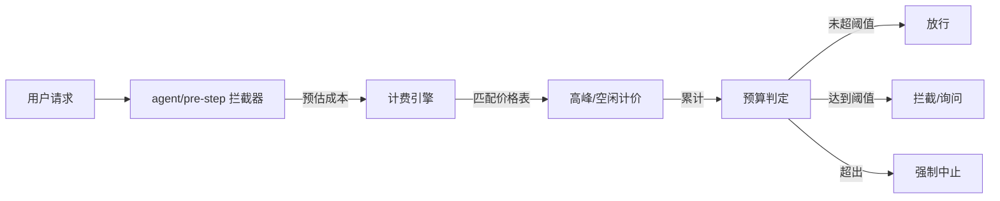

<div align="center">

<a id="dsh-budget-guard-plugin"></a>

# 🏦 dsh-budget-guard-plugin

**给 DSH 的每一次任务加一条预算线：支持实时核算、自动拦截、预估降级。支持在设置页 UI 中查看、修改或新增模型及模型单价。**

<a href="./README.en.md">English</a> · <strong>简体中文</strong>

[](https://www.npmjs.com/package/dsh-budget-guard-plugin)
[](https://www.npmjs.com/package/dsh-budget-guard-plugin)
[](https://github.com/Existence001100/dsh-budget-guard-plugin/actions/workflows/ci.yml)
[](./LICENSE)
[](https://nodejs.org/)
[](https://awesome-dsh-plugin.com)

</div>

给 DSH（DeepSeek Harness）的每一次任务加一条预算线：按 **人民币金额** 或 **Token 数量** 限制消耗，接近上限时预警，达到阈值时自动中止（`auto`）或询问你“继续 / 中止”（`manual`），并在**每轮结束后**估算还需多少步、还要花多少钱。支持设置页 UI 中查看、修改或新增模型及模型单价。

**🚀 快速安装**

```sh
dsh plugin --profile web add dsh-budget-guard-plugin
```

安装后请重启 Web Profile。完整步骤（GitHub 安装、更新/卸载、本地开发）见[快速开始](#快速开始)。

[🚀 快速开始](#快速开始) · [✨ 核心能力](#它能做什么) · [⚙️ 配置](#配置项) · [🐛 反馈](https://github.com/Existence001100/dsh-budget-guard/issues)

## 目录

- [它能做什么](#它能做什么)
- [拦截流程](#拦截流程)
- [快速开始](#快速开始)
- [兼容性](#兼容性)
- [设置预算](#设置预算)
  - [模型及价格设置（设置页底部）](#模型及价格设置设置页底部)
- [配置项](#配置项)
- [高峰 / 空闲计价](#高峰--空闲计价)
- [怎么核对金额（和官网账单对不上时）](#怎么核对金额和官网账单对不上时)
- [冷启动与快照](#冷启动与快照)
- [未知模型 / 价格未知](#未知模型--价格未知)
- [父任务 / 子代理聚合](#父任务--子代理聚合)
- [重试 / 时段归属](#重试--时段归属)
- [手动模式：临时放行 vs 关闭提示](#手动模式临时放行-vs-关闭提示)
- [HTTP 路由](#http-路由)
- [只读字段](#只读字段)
- [每轮预估怎么算（不花额外 Token）](#每轮预估怎么算不花额外-token)
- [界面](#界面)
- [拦截行为细节](#拦截行为细节)
- [零依赖与 Config 投影](#零依赖与-config-投影)
- [构建与测试](#构建与测试)
- [已知边界](#已知边界)
- [License](#license)

## 它能做什么

| 图标 | 能力 | 实现方式 |
| --- | --- | --- |
| 🚦 | 预算声明 | 插件 Config（全局默认）或对话里的 `/budget` 命令（仅当前会话） |
| 💸 | 实时核算 | 从会话日志的 `assistant/message.usage` 累计 input/output/cache Token；每条消息按它**实际发生时刻**的北京高峰/空闲价计费 |
| 💰 | 价格自定义 | 无需折腾 JSON 文件，直接在设置页 UI 中查看、修改或新增模型单价（完美适配官方调价或 One API 代理），保存后立即热更新生效 |
| 🛑 | 自动拦截 | `agent/turn-stopping` 达到 `interceptRatio` 时调用 `agent.cancel({ kind: 'hook' })`；`agent/pre-step` 在超预算时拒绝下一步，避免继续产生模型调用 |
| ✋ | 手动拦截 | `manual` 模式只提示，不自动取消；composer 下方的预算条出现「继续 / 中止」按钮 |
| ⚠️ | 预警 | 达到 `warnRatio`（默认 80%）在预算条与每轮卡片上显示醒目提示 |
| 📐 | 任务前粗估 | 首轮开始前给出 3–12 步、金额/Token 范围与预算占比（可关） |
| 📊 | 降级预估 | 只展示**近期历史燃烧率**（最近 3 轮/步的平均消耗）；只有模型明确写出计划时才显示剩余步数与剩余金额，**不预测未来总花费**；不新增 LLM 调用 |
| 🧭 | 输出位置 | `estimateOutput`: `chat`（每轮卡片）、`sidebar`（右侧栏常驻页）、`both`（默认）。右侧栏页由 `dsh-better-sidebar` 提供；没有该 bundle 时自动退回卡片 |
| ✅ | 配置校验 | 插件加载时校验枚举、数值范围、未知键；无效值直接报 `ValidationError` |
| 🛡️ | 安全护栏 | `/config/save` 与 `/action` 默认只接受本机 loopback 请求；冷启动快照 + 从会话日志重放，保证账目可恢复、不被重复计费 |

## 拦截流程



每条 `assistant/message` 都按它自己的 `event.time` 逐条计价后累计；判定使用金额与 Token 两条独立预算线，**任一先到即触发**，值为 0 的维度不参与。

## 快速开始

### 环境要求

- DeepSeek Harness `0.2.x` 或更高版本；
- Node.js `>=22.13`；
- `PATH` 中存在 pnpm，供 `dsh plugin` 调用。

### 从 npm 安装（推荐）

```sh
dsh plugin --profile web add dsh-budget-guard-plugin
```

DSH 会识别包内的 `dsh.bundle` manifest，并自动把 `dsh-budget-guard-plugin` 加入 Web Profile。安装完成后，请重启正在运行的 Web Profile。

安装后 bundle 会插入一行 `budget-guard`，默认配置为：

```yaml
- insert:
    - id: budget-guard
      name: 'dsh-budget-guard-plugin'
      config:
        interceptMode: auto
        enableTurnEstimate: true
        estimateOutput: both
```

`package.json` 已声明 `dsh.bundle.patch`、`exports["./client"]`、`locale/*.json`、`icon`，`files` 包含 `lib/` 与 `cordis.patch.yml`，因此打成的 npm 包也能被 `dsh plugin` 识别。

### 从 GitHub 安装

```sh
dsh plugin --profile web add github:Existence001100/dsh-budget-guard-plugin
```

需要测试 `main` 中尚未发布的变更时，可以使用 GitHub 来源；如需可复现安装，请固定到具体 commit。

### 更新或卸载

```sh
dsh plugin --profile web update dsh-budget-guard-plugin
dsh plugin --profile web remove dsh-budget-guard-plugin
```

执行任一操作后请重启 Profile，确保运行时 composition 与已安装 Bundle 一致。

### 安装本地 Checkout 进行开发

```sh
git clone https://github.com/Existence001100/dsh-budget-guard-plugin.git
cd dsh-budget-guard-plugin
pnpm install --frozen-lockfile
node build.mjs
dsh plugin --profile web add .
```

插件自带的 `cordis.patch.yml` 会把 `budget-guard` 插入宿主 composition，对所有会话生效。

## 兼容性

| 组件 | 支持或持续验证范围 |
| --- | --- |
| DeepSeek Harness | `0.2.0` 及以上版本。持续跟进 DSH 宿主 API 变更。 |
| Node.js | `^22.13.0` 与 `>=24.0.0` |
| pnpm | 最新版，配合 `dsh plugin` 使用 |
| 操作系统 | Windows / macOS / Linux |

本插件基于 DSH 官方扩展点（`agent/turn-stopping`、`agent/pre-step` 等）开发，不侵入模型核心逻辑。如果在使用中发现特定版本的 DSH 存在接口不兼容，请提交 [Issue](https://github.com/Existence001100/dsh-budget-guard/issues)。

## 设置预算

### 方式一：对话命令（推荐，只影响当前会话）

```text
/budget 2.5              # 本次任务 ¥2.50
/budget 20000 tokens     # 本次任务 20k tokens
/budget 20k              # 同上
/budget both 2 20000     # 金额 + Token 双上限（任一先到即触发）
/budget                  # 查看当前预算、已用、进度与上一轮预估
/budget continue         # manual 模式：继续，再增加约 10% 预算后再次提示
/budget abort            # manual 模式：中止当前轮次
/budget unlock           # 解除本会话的预算拦截（费用仍统计，但不再中止/拦截）
/budget lock             # 恢复本会话的预算拦截
/budget off              # 清除会话覆盖，回到 Config 默认值（同时恢复拦截）
/budget 0                # 同 /budget off；/budget both 0 0 也一样
/budget reset-snapshot   # 丢弃本会话的缓存与快照条目，按会话日志重新计费（排障用）
```

**预算为 0（未设置）时不会拦截。** `budgetAmount` 与 `tokenBudget` 默认都是 `0`，含义是“这条线不存在”：不会取消轮次、不会在 `pre-step` 拒绝、不会触发 `warnRatio` 预警、也不会弹“是否继续”。只有金额或 Token 任一 > 0 才启用阈值判定。`/budget 0` 与 `/budget both 0 0` 等价于 `/budget off`：清除会话覆盖，回到 Config 默认值；如果默认值也是 0，本会话彻底无限制。你没设预算就会被拦，是 bug 而不是设计——有回归测试钉住（花掉几十万 token 也不 cancel / reject）。

没有预算时 UI 也一致：预算条显示 `未设置预算 · 已用 ¥…`，估算卡片/右侧栏显示「未设置预算 · 仅记录金额」而不是伪造的「预算已用约 0%」，进度条为空，不出现任何手动放行按钮；`/budget continue`、`/budget suppress` 在没有预算时是无操作并给出提示（不会提前记下放行额度或“已关闭提示”）。

`/budget reset-snapshot` 用于“明细无法回滚导致结算被拒绝”的排障：

- **清理范围**：本会话的计费缓存（`cost`、`stepCharges`、`settledCharges`、结算水位、`blockedSettlements`）全部重建。
- **保留**：「继续 / 不再提示」等手动决定与 `/budget` 设的预算声明——它们是用户的选择，不是账目。
- **一次性操作**：不写「可重放的效果」。日志里那条 `command/run` 在重启重放时只会被识别成一个无副作用的参数，**不会**每次重启都再清一次缓存。
- **多实例边界**：执行时立即按日志重算并写一份**时间戳更新**的快照（墓碑）；同一会话在目录里“`savedAt` 最新者为准”，所以别的实例那份旧缓存不会被读回来。若另一个实例在 reset **之后**又写入新状态，则以新状态为准（那是它自己折得更远的日志视图）。
- **reset 之后**：下一次读取就是重算后的真实状态——不会短暂显示 `loading`，也不会先归零再跳回；日志里确实有花费时，重算结果与日志一致。

命令不会调用模型，只写一条 `command/run` / `command/done` 日志；重启后插件会从 `command/run` 重放这条预算声明。

### 方式二：输入框下方预算条（只影响当前会话）

输入框下方只保留一行 `未设置预算 · 已用 ¥0.00`（有预算时是 `预算 ¥2.00 · 已用 ¥1.15`）。点击这行会展开：

- 费用明细：输入（未命中）/ 缓存命中 / 输出、峰价与谷价、最近模型、当前时段、Token、未知模型提示；
- 「设置本次预算…」按钮：展开金额与 Token 输入框，保存后通过同一条 `/budget` 命令写入会话日志，因此可重放、可审计。

### 方式三：Config 默认值 / 设置页

在 profile 的 `cordis.patch.yml` 中覆盖本行，或打开 **设置 → 预算护栏**。设置页覆盖**常用**可调项（21 个），每项都带一句说明：

| 分组 | 可调项 |
| --- | --- |
| 拦截 | 拦截模式（auto / manual 滑动开关）、预警比例、拦截阈值、未知模型告警、累计放行上限、手动硬停倍数、每步前硬拦截 |
| 每轮预估 | 每轮预估开关、输出位置（对话卡片 / 右侧栏 / 两者）、预估最小间隔、任务前粗估开关 |
| 默认预算 | 默认金额、默认 Token、币种 |
| 快照 | 冷启动快照开关、保留会话数、非活跃保留天数、明细保留轮数、每会话结算记录上限（`snapshotPath` 不在此处，见下） |
| 访问 | 仅本机可改设置（`requireLocalControl`）、仅本机可操作本轮（`requireLocalAction`） |
| 模型价格 | 查看当前生效的所有模型单价、新增自定义模型、覆盖内置/official 价格并实时热更新（保存至 `local-prices.json`） |

**4 个键不在表单里**，只能手改 `cordis.patch.yml`：`snapshotPath`（自由路径）、`allowedOrigins`（数组）、`holidays`（日期数组）、`useBuiltinHolidays`（与 `holidays` 联动的开关）。测试会断言「表单键 + 这 4 个 == `DEFAULTS` 的全部键」，所以新增 Config 键时漏加控件会直接测试失败。

比例项以百分数输入（`85` 即 `0.85`）。底部显示价格来源、节假日来源、跨源白名单数量、右侧栏是否可用。

点「保存全部设置」后走 `POST /dsh-budget/config/save`：Host 把补丁合并进当前 Config，再用**与插件加载完全相同的校验器**校验整体，因此跨字段规则（`warnRatio ≤ interceptRatio`、放行上限必须低于硬停线）会在这里就被拒绝，并返回具体原因；未知键直接 400。写回的是当前 bundle 行的 `config`，与手工编辑 `cordis.patch.yml` 等价。

> 0.3.10 修复：设置页曾把已经是比例的 `warnRatio: 0.8` 再除以 100 变成 `0.008`，导致「保存全部设置」每次都被 Host 以 `warnRatio must be ... between 0.01 and 1` 拒绝。现在提交的仍是 `0.8 / 0.95 / 0.2`。

### 模型及价格设置（设置页底部）

在设置页的最下方，提供了一个直观的「模型价格」编辑器。你可以直接在 UI 中以表格形式查看、新增或修改各个模型的高峰/空闲单价（完美适配官方调价或 One API 等三方代理）。修改保存后会立即热更新生效，无需手动去改 JSON 文件。

- 表格列出**合并后实际生效**的全部模型，按「高峰 / 空闲」两行展示 `未命中 / 命中 / 输出` 三个单价，单位统一为 **元 / 1M tokens**；
- 每行右侧标注价格来源：`内置` / `official` / `用户自定义`（local），鼠标停在数字上能看到字段名；
- 「编辑」把该行的 6 个单价变成输入框（清空某项表示继续继承下一层价格，不会被写成 0），「添加新模型」可手动输入模型名（如 `gpt-4o`，要和 `message.source.model` 完全一致）；
- 「保存价格」调用 `POST /dsh-budget/prices/save`，把改动**只写入 `$DSH_HOME/budget-guard/local-prices.json`**，然后 Host 重新执行 `finalizePriceBook`，**下一轮对话立即按新价计费**，不需要重启 DSH；
- 用户自定义的模型有「删除」按钮：从 `local-prices.json` 中移除，回退到 official / 内置价（如果两层都没有，则变回“未定价模型”）；
- 保存成功后的提示固定为：**「价格已更新并生效。注意：历史账目不会自动重算，如需按新价重算本会话，请执行 `/budget reset-snapshot`」**。

> 价格与 Config 是两套保存路径：改单价点「保存价格」，改预算/拦截参数点「保存全部设置」，互不影响。

```yaml
- id: budget-guard
  config:
    budgetAmount: 2
    tokenBudget: 0
    currency: CNY
    warnRatio: 0.8
    interceptRatio: 0.95
    interceptMode: auto
    enablePreEstimate: true
    enableTurnEstimate: true
    estimateOutput: both
    turnEstimateMinInterval: 1500
    enforceAtPreStep: true
    holidays: []
```

> 金额与 Token 是两条独立预算线；两条都配置时，**任意一条**达到阈值就触发拦截。未配置（值为 0）的维度不参与拦截。

## 配置项

| 键 | 默认值 | 说明 |
| --- | --- | --- |
| `budgetAmount` | `0` | 每个会话默认金额预算；`0` 表示不设金额上限 |
| `tokenBudget` | `0` | 每个会话默认 Token 预算；`0` 表示不设 Token 上限 |
| `currency` | `CNY` | 只支持 `CNY` / `RMB`；两者都是人民币，统一显示 `¥`（不做汇率换算） |
| `warnRatio` | `0.8` | 预警比例，必须 ≤ `interceptRatio` |
| `interceptRatio` | `0.95` | 拦截阈值（0.01–1） |
| `interceptMode` | `auto` | `auto`：自动取消；`manual`：只提示，等用户点「继续 / 中止」 |
| `enablePreEstimate` | `true` | 任务开始前给出粗估 |
| `enableTurnEstimate` | `true` | 每轮结束后显示消耗估算：未提供计划时只展示近期历史均值，不做未来外推 |
| `estimateOutput` | `both` | `chat` / `sidebar` / `both` |
| `turnEstimateMinInterval` | `1500` | 两次预估的最小间隔（毫秒），避免连续快轮重复计算 |
| `enforceAtPreStep` | `true` | 在 `agent/pre-step` 也做硬拦截，防止超预算后继续买模型调用 |
| `holidays` | `[]` | 法定节假日（`YYYY-MM-DD`）。非空时**完全覆盖**内置表；为空 / 全部非法且 `useBuiltinHolidays=true` 时回退内置表 |
| `useBuiltinHolidays` | `true` | 为空时是否允许回退内置 2024–2026 节假日表；`false` 时为空表示“无节假日”；2027 起内置表超范围会 warn |
| `allowedOrigins` | `[]` | 开发用跨源白名单；生产默认只允许同源，见“HTTP 路由” |
| `enableSnapshot` | `true` | 将累计状态写入冷启动快照 |
| `snapshotPath` | `''` | 快照基路径；空值时使用 `$DSH_HOME/budget-guard/snapshots.json`，实际写入 `<stem>.<pid>.json` |
| `snapshotMaxSessions` | `200` | 每个实例快照最多保留的会话数；活跃会话优先保留 |
| `snapshotKeepTurns` | `8` | 快照保留最近多少轮的全部 `stepCharges` 明细；更早的重试会被拒绝并 warn，不会重复累加 |
| `snapshotMaxAgeDays` | `30` | 非活跃快照的最长保留天数；`0` 表示不按时间清理 |
| `unknownWarnRatio` | `0.2` | 未定价 token 占比达到此值时提示“按最高价估算，实际可能偏低” |
| `maxGrantedPercent` | `30` | manual「继续」最多累计放行比例；默认终值 130%，严格低于 142.5% 硬停线 |
| `manualHardStopRatio` | `1.5` | manual 模式（含 suppress）超过 `interceptRatio × 该值` 时强制中止 |
| `perSessionMaxSettled` | `2000` | 每个会话保留多少条已结算摘要；超过后新步骤只记标记，重试会被拒绝而不是替换 |
| `requireLocalControl` | `true` | `/config/save`（改全局预算）只接受本机（loopback）请求；远程 GUI 改预算需显式关闭 |
| `requireLocalAction` | `true` | `/action`（继续 / 中止 / 设置本次预算）只接受本机请求；可单独关闭以支持远程 manual 操作 |

单价只影响“金额”核算；Token 预算始终按真实 usage 计算。价格不在 Config 里硬编码，见下一节。

`GET /dsh-budget/config` 还返回 4 个**只读**字段（`output` / `holidaysSource` / `priceSources` / `server`），它们不能通过 `/config/save` 写回；含义见「HTTP 路由」下的「只读字段」小节。

## 高峰 / 空闲计价

- 时区固定 `Asia/Shanghai`（UTC+08:00，无夏令时），用固定偏移读取北京时间，不依赖时区库。
- **高峰**：周一至周五 `09:00–12:00`、`14:00–18:00`（左闭右开）；其余时间、周六周日、`holidays` 中的日期全天为空闲。
- 判定基于**每条 `assistant/message` 的 `event.time`**，不是渲染时的当前时间；同一会话跨峰谷时逐条计价后求和。
- 单价单位：**元 / 百万 token**，结构：

```json
{
  "models": {
    "deepseek-flash": {
      "peak":    { "input_miss": 2, "input_hit": 0.04, "output": 8 },
      "offpeak": { "input_miss": 1, "input_hit": 0.02, "output": 4 }
    }
  }
}
```

> 0.4.0 修正：`output` 回到官方标价 **`8`（高峰）、`4`（空闲 50%）**；输入未命中 `2 / 1`、缓存命中 `0.04 / 0.02`（DeepSeek 官方调价后）。同时删除了独立的缓存写入计价项：缓存写入 token 已包含在 `input_miss` 中，按未命中价计费。

- 优先级：代码内置默认 → [prices/official-prices.json](prices/official-prices.json) → `prices/local-prices.json`（插件目录，旧位置，仍兼容） → **`$DSH_HOME/budget-guard/local-prices.json`（设置页写入，优先级最高）**。
- **推荐用设置页改价**（设置 → 预算护栏 → 模型价格），它只写 `$DSH_HOME/budget-guard/local-prices.json`，不碰 npm 包目录，保存后**热更新立即生效**，不需要禁用/启用插件。手工改文件仍然可行：把 [prices/local-prices.example.json](prices/local-prices.example.json) 复制为 `$DSH_HOME/budget-guard/local-prices.json`（或插件目录下的 `prices/local-prices.json`，后者在升级时会被覆盖）。
- 仓库里的 `official-prices.json` 是**保守示例值**（插件不允许联网拉价）；上线前请用 `local-prices.json` 覆盖为你实际账单上的官方单价。
- 改价只影响**之后的结算**：已结算的 charge 保留结算当时的单价（`/budget debug` 能看到），历史账目不会自动重算 —— 需要本会话按新价重算时执行 `/budget reset-snapshot`。
- `offpeak` 缺失字段默认取 `peak × 50%`。价格表只有 `input_miss` / `input_hit` / `output` 三个字段；缓存写入没有单独单价。
- 未知模型：token 计入 `unknownTokens`，**展示费用按真实已知计（未定价部分为 0）**，拦截判定另用 `shadowCost`；预算条与明细显示未知模型警示。
- 内置节假日表是覆盖 2024–2026 的保守清单；请按官方安排通过 `holidays` 覆盖。
- 缺字段：按 0 计并记录 warn；非法时间戳：跳过该条并 warn。
- DSH 的 `usage.inputTokens` 已经是“未命中输入”，`cacheReadTokens` 是额外字段；计价按 `inputTokens × input_miss + cacheRead × input_hit`，不会把缓存命中重复按未命中收费。对把缓存包含在 `inputTokens` 里的 OpenAI 风格 usage，代码会检测 `totalTokens` 关系并先减去 `cacheReadTokens`。

## 怎么核对金额（和官网账单对不上时）

插件不调用计费接口，它只是把 `assistant/message` 里的 usage 按本地价格表换算。核对三步：

1. **看口径**：`/budget prices` 打印字段映射与每 1M token 的单价；预算条明细底部也有一行「计费口径（每 1M token，高峰/空闲价）」。
2. **看单笔**：`/budget debug 5` 打印最近 5 笔结算的 key、时间、时段、各项 token、单价、单项金额与合计，并附上 Host 传来的**原始 usage JSON**；单价取结算当时记录的 `charge.price`，事后再改价格表也不会让公式和记录值对不上。
3. **清缓存重算**：怀疑旧快照累加有问题时，`/budget reset-snapshot` 丢弃缓存并按日志重放。

常见差异来源：

| 来源 | 说明 |
| --- | --- |
| 缓存命中率 | 命中价通常只有未命中价的 1/10；命中率从 90% 掉到 60%，金额能翻几倍——这是账单差异最常见的原因 |
| 时段判定 | 工作日 `09–12`、`14–18` 高峰（2×），其余与周末/节假日按基准价；`/budget debug` 会标出当时的判定 |
| 四舍五入 | 单项线性计算，合计保留 6 位小数后展示，对账差几厘属正常 |
| 未定价模型 | 展示按真实已知（通常 0），拦截按“已加载价格表里的最高单价” |
| 厂商调价 | 内置价是示例值；在设置页「模型价格」里改，或直接改 `$DSH_HOME/budget-guard/local-prices.json`，无需改代码 |

## 冷启动与快照

- 每条快照包含最近 `snapshotKeepTurns` 轮的全部 `stepCharges`（`sessionId:turn:step`、`peakCost/offpeakCost`、`eventTime`、`seq`）。
- 每个 `assistant/message`、`turn/end`、`command/run` 之后都**同步 flush** 一次快照（其余事件走 1.5s 防抖）：这三个点会改变结算或预算声明，热重载不执行 effect cleanup 时也不能丢。
- 除了 `stepCharges`，每条快照还保存 `settledCharges`：每个已结算 step 的**回滚摘要**，14 个字段固定顺序（`tier, unknown, cost, shadow, tokens, input, inputMiss, output, cacheRead, 三个分项, model, seq`）。某 step 的明细被轮次截断后，重试仍能「先减旧、再加新」，**不再拒绝**。`byModel` 的 `calls`/峰谷拆分与 `byTier.tokens` 不需要单独入摘要：它们由 `(model, tier, cost, tokens)` 推导（见 `addBucket` 的契约），摘要里这四个值已经够用。
- `settledCharges` 有两级上限：最近 `perSessionMaxSettled`（默认 2000）条保留**可回滚摘要**；更早的记录降级为 `null` 标记（约 30 字节，只表示“已计费”），其重试会被**拒绝**并计入 `counters.blockedSettlements`，绝不会重复计费。整张表硬上限为 `2 × perSessionMaxSettled`，超出后丢弃**最早**的记录（`counters.settledEvicted` 计数 + 警示）：新步骤永远会被记录（先摘要、后标记），只有被丢弃的极旧记录若重试才会重复计费。
- 降级是**批量**的：摘要数达到 cap 后，一次把最早的 64 条（`DEMOTE_BATCH`）改成标记，然后接下来 64 次结算都是 O(1) 追加。所以稳态是**摊还 O(1)**，不会出现每步扫描 2000 条的 O(n²)。
- 审计计数（`replacedSettlements`、`blockedSettlements`、`settledEvicted`、`invalidTimeMessages`）在多进程合并时取 **max**，是保守下界：两个进程可能各替换/拒绝/逐出了不同的 step，真实总数只会更大。它们适合看“有没有发生”，不适合精确对账。
- 这样设计的原因是：重试只发生在**仍在进行的那一轮**，所以“最新窗口保留摘要、旧记录只留标记”既保证替换正确，又让快照体积有界。
- 每个实例写入自己的 `<stem>.<pid>.<startedAt>.json`，读取时合并同目录所有 `<stem>*.json`；同一会话取 `savedAt` 最新记录。
- **多实例写入改为合并**：合并**永远不加钱**，只对账记录。水位取 `max(lastSeq, settledSeqWatermark)`：
  - `lastSeq` = 已折叠的最大事件 seq；`settledSeqWatermark` = **已结算** charge 的最大 seq，逐出不会让它回退。
  - 进入合并的条件是 `磁盘 lastSeq >= 本进程 lastSeq`，即磁盘在同一份日志上折得不比本进程浅。此时本进程每一笔结算的 `seq` 都 ≤ 磁盘水位，磁盘总额必然已经包含它们，**所以合并没有“补金额”这条路径**（`adopted` 计数在 0.3.3 已删除）。
  - 这条规则专门防「逐出」：逐出会删掉最早的 `settledCharges` 记录，但金额仍留在 `cost` 里。若按“磁盘有没有列出这个 key”来判断，被逐出的 step 看起来像“磁盘从没结算过”，会被另一个进程补入并**重复计费**。
  - `seq` 不超过水位的 key 才补一个**标记**（`null`，无摘要、无金额），作用仅是让后续重试被拒绝而不是重新计费；**超过水位的 key 什么都不补**，留给磁盘自己结算（补了标记会让磁盘拒绝自己的第一次结算）。不会搬运摘要：磁盘记的是它自己的金额，搬过来做回滚会与总额不一致。
  - warn 会区分两种结果：`kept N marker(s) without money` / `dropped N already-known key(s)`。**没有“补金额”也没有“留给磁盘”那两个计数**——合并路径上不存在这两种情况（前者在 0.3.3、后者在 0.3.4 被确认为不可达并删除）。
- **`lastSeq` 相等时**：仍以本进程为写入方（保留最近明细的可替换性），只把 `settledSeqWatermark` 向磁盘最大值纠偏，**绝不回退**（回退会让下次合并误判“磁盘没见过很多 step”）。日志里是 `snapshot watermark restore`。
- `lastSeq` 的语义：**per-session 的日志水位**，等于该状态已折叠过的最大 `session/event.seq`；合并时取 max，快照里存于 `session.lastSeq`，冷启动用它作为重放起点（`event.seq <= lastSeq` 的事件跳过）。
- 清理旧实例文件时按文件名里的 `<pid>.<startTs>` 判断：本进程 pid 但 `startTs` 不是本次启动（pid 复用）的文件直接删除；其他 pid 只要进程仍存活就不删，否则按 `snapshotMaxAgeDays` 清理。`SNAPSHOT_VERSION=2` 起的文件才会被读取；0.3.x 的旧格式不会被半解析，直接按日志重放重算。
- 冷启动读取快照，UI 先显示 `≈¥17.09（待校正）`，不会拿 0 冒充真实值；`agent/created` 或新事件到达后按日志重放校正，`stale` 变回 `false`。
- 没有任何状态且也没有快照时，接口返回 `loading: true`，预算条显示“预算状态加载中…”。
- `snapshotMaxSessions` / `snapshotMaxAgeDays` 控制增长：活跃会话优先保留；非活跃快照按年龄清理。损坏的 JSON 文件 warn 后跳过，不影响其他实例。
- 快照是派生缓存，不是真相：真正的累计仍来自会话日志；日志比快照新时以日志为准。

**结构变更（0.4.0）**：快照版本升到 2，摘要从 16 项减为 14 项（去掉两个缓存写入位置），旧的 0.3.x 快照不再读取。

```json
// 0.3.x（不再读取）
{ "settledCharges": [["s:1:1", [1,0,0.002,0,1000,1000,1000,0,0,0,0.002,0,0,0,"deepseek-chat",3]]] }
// 0.4.0
{ "settledCharges": [["s:1:1", [1,0,0.002,0,1000,1000,1000,0,0,0.002,0,0,"deepseek-chat",3]],
                     ["s:1:2", [1,0,0.002,0,1000,1000,1000,0,0,0.002,0,0,"deepseek-chat",4]]],
  "settledTrimmed": false, "settledOverflow": false, "settledEvicted": 0,
  "settledSeqWatermark": 4,
  "stepCharges": [["s:1:2", { "cost": 0.002, "...": "..." }]] }
```

摘要数组顺序固定为 14 项：`[tier(1=peak), unknown(1), cost, shadow, tokens, input, inputMiss, output, cacheRead, bdMiss, bdHit, bdOut, model, seq]`。`seq` 有三个角色：① 审计；② 跨进程合并的水位比较（见上节）；③ **不参与** `applyCharge` 的加减——替换判定以 `(sessionId, turn, step)` 这个 key 为准。

`settledSeqWatermark`（0.3.2 新增）是“已结算 charge 的最大 seq”，逐出与降级都不会让它回退。旧快照没有该字段时按 `lastSeq` 推导（偏向“已结算”，宁可拒绝补入也不重复计费）。

旧快照兼容：版本 2 之前的文件会被忽略，冷启动按会话日志完整重放。这样 0.3.x 的 16 项摘要不会用错误布局回滚金额。

**15 项旧摘要**（`seq` 字段出现之前的布局）：这类记录**无法回滚**。处理方式是“宁可少计、不可重复”——该 key 的旧结算不再可替换，后续重试会被**拒绝**并计入 `blockedSettlements`，账目停在旧值；合并时它也只会变成标记，永远不会被补金额。

**看到「有 N 次结算被拒绝」怎么办**（`blockedSettlements`）：

- 它是**历史累计次数**，只增不减——反映“有多少次重试被拒绝”，**不代表当前有多少条坏数据**。反复重试会让这个数字一直涨，账目本身并没有变得更糟。
- 常见来源：旧版本快照里的 15 项摘要、被逐出的极旧步骤、手工编辑过的快照文件。
- 恢复路径（账目以**会话日志**为准，快照只是缓存）：
  1. 在会话里执行 `/budget reset-snapshot`：丢弃**本会话**的缓存与快照条目，并按日志重新计费。它会写一份时间戳更新的墓碑快照，因此其他实例的旧缓存不会被读回来（详见上一节的“多实例边界”）。
  2. 想彻底清空：关闭 DSH，删除 `$DSH_HOME/budget-guard/snapshots.*.json`，再启动。所有会话都会从日志重新重放（会丢掉冷启动加速，账目更准确）。
- 两种做法都不会改会话日志，也不会改任何预算设置。

## 未知模型 / 价格未知

- 未定价模型 token 计入 `unknownTokens`。**展示费用按真实已知计算（通常为 0），拦截判定使用 `shadowCost`** —— 两者必须同时显示，否则会出现“看着没超却被拦”。
- `shadowCost` 的口径固定为：取**已加载价格表**中「整模型 × 整时段」总价最高的那一个（不是逐字段取最高，避免组合出不存在的超高价；也不按当前时段打折），即“最贵模型的最贵时段价”。单元测试固定了这条规则。文案统一写成「已加载价格表中的最高单价」，不要写成“全网最高价”。
- 有 shadowCost 时，预算条主行显示 `已用 ¥1.20（判定 ¥2.50，含未知估算）`，真实值与拦截值同时可见；明细展开“未知估算（仅用于拦截判断）”。
- 未定价 token 占比达到 `unknownWarnRatio`（默认 20%）时提示“未定价模型占 X% token，已按已加载价格表中的最高单价估算拦截，实际可能偏低”。
- 预算条追加 `· 价格未知`，文字变黄并带 `⚠`。
- `/budget prices` 打印已加载模型、价格来源、未定价模型清单和处理方式。
- 补齐方式：在设置页「模型价格」中添加该模型（写入 `$DSH_HOME/budget-guard/local-prices.json`，保存即生效），或直接编辑该文件的 `models`；旧位置 `prices/local-prices.json` 仍会被读取。
- 未做“同厂商均价”兜底：那会制造另一个看似精确但不准确的金额；当前选择明确显示“价格未知”，并在拦截层使用最高已知单价保护。

## 父任务 / 子代理聚合

- 每条状态记录 `parentSessionId`（来自 `SessionHeader.parentSession`）；`/dsh-budget/state` 附带 `aggregate`：
  `{ self, children[], childrenCost, totalCost, childrenTokens, totalTokens, complete, scope }`。
- `children[]` 是递归展开的，带 `depth`；`childrenCost` 包含所有已发现后代。
- `complete` 目前只表示“已发现集合里没有快照-only/待校正子代理”，并附 `scope: 'discovered'`；DSH 没有稳定的 `SessionHeader.children` 时无法证明未加载子代理不存在（`TODO: 需确认`）。
- 预算条明细显示“含子代理：自身 ¥A + 子代理 ¥B = ¥C”，并可展开每个子代理。
- 聚合只影响展示，**不改变**父/子各自的预算拦截；父任务统一限额仍需 Host 提供稳定 `taskId`（`TODO: 需确认`）。

## 重试 / 时段归属

- 每笔结算封装为单一 `Charge`，回滚时 `applyCharge(state, charge, -1)` 整体减掉 `cost/shadowCost/totalTokens/input*`、`costBreakdown`、`byModel`、`byTier`、`unknownTokens/unknownModels`；新增维度不会漏。被截断的结算用同字段的摘要回滚，口径一致。
- 「继续」默认最多累计放行 30%（终值 130%），低于硬停线 `0.95 × 1.5 = 142.5%`；Config 校验会拒绝 `1 + maxGrantedPercent/100 >= interceptRatio × manualHardStopRatio` 的组合，错误信息会写出具体数值和该改哪个字段。
- `counters.replacedSettlements` / `blockedSettlements` / `lastSeq` / `settledCharges` 都是 per-session 且写入快照，重启后审计计数保留；三者都会出现在 `/dsh-budget/state` 的 `counters` 里，预算条明细也会显示“有 N 次结算被拒绝 / 已结算 M 条 / lastSeq X”。
- 时段归属使用 `assistant/message` 的 `event.time`（提交时刻），不是渲染时间；`toEpochMs` 支持 `Z` / `+08:00` / 不带时区（按 Asia/Shanghai 解释并 warn）三种格式。
- 构造跨整点流式用例时，按“提交时刻”验收。

## 手动模式：临时放行 vs 关闭提示

- `manual` 达到阈值时只提示，不取消。
- 「继续 (+10%)」每次放行 10% 预算，提示显示“累计已放行 X%”；累计达到 `maxGrantedPercent`（默认 30%，终值 130%）后按钮变为「已达上限」，只能中止或 `/budget off`。也就是说默认**点 3 次就到顶**，第 4 次已经没有“继续”可点。
- 「不再提示」设置 `manualSuppressed`：本次任务内不再弹提示，但仍记录费用；超过 `interceptRatio × manualHardStopRatio`（默认 1.5，即约 142.5%）时仍强制中止，避免完全绕过护栏。
- 「中止」调用 `agent.cancel({ kind: 'user' })`。

### 被拦截之后怎么继续（auto 模式同样适用）

`auto` 模式到达阈值会直接取消本轮。取消不是终点：预算条下方会出现一行

```text
本轮已因预算中止。 [继续 (+10%)] [解除限制] [查看明细]
```

- **继续 (+10%)**：把下一次拦截线推后约 10% 预算，够你再跑几步；累计上限仍是 `maxGrantedPercent`。
- **解除限制**：本会话**不再因预算中止或拒绝**（`/budget unlock`，等价于在命令里敲一次）。费用照常统计、明细照常更新，只是不再拦你——这才是“被卡住后能继续工作”的出口。输入 `/budget lock`、或在命令里重设一次预算（`/budget 3`）都会自动恢复拦截。
- 解除状态写在快照里，重启/重放后仍保持；预算条会显示 `· 已解除限制`。

> 设计取舍：解除限制是**按会话**的，不写回 Config，不影响其他会话；它也不会清掉已记录的消费。
- `/budget off` 清除会话覆盖、回到 **Config 默认预算**，并按实际配置分四种文案：

| 默认配置 | 文案 |
| --- | --- |
| 金额 + Token | `已清除会话覆盖，恢复默认预算：默认金额 ¥2.00 / 默认 Token 20.0k tokens（仍会按默认预算拦截）。` |
| 仅金额 | `…恢复默认预算：默认金额 ¥2.00（仍会按默认预算拦截）。` |
| 仅 Token | `…恢复默认预算：默认 Token 20.0k tokens（仍会按默认预算拦截）。` |
| 都没有 | `已清除会话覆盖；当前没有默认预算，本会话不再拦截。` |

只有金额与 Token **都为 0** 才算“没有默认预算”；只设了 Token 线时同样会继续拦截。

## HTTP 路由

- `/dsh-budget/state`、`/dsh-budget/action`、`/dsh-budget/config`、`/dsh-budget/config/save`、`/dsh-budget/prices`、`/dsh-budget/prices/save`。
- `/action` 的 `set-budget` 传 `amount: 0, tokens: 0` 等价于 `/budget off`：清除会话覆盖、回到 Config 默认预算（不需要 live agent）。
- `/config` 返回**全部** Config 键，外加四个只读字段 `output`、`holidaysSource`、`priceSources`、`server`（见下节「只读字段」）。
- `/config/save` 的键白名单直接来自 `DEFAULTS`：新增 Config 键自动可保存；未知键 400 `unknown-key`，越界/枚举错误/跨字段冲突统一 400 `invalid`，`issues` 是 `[{ path: ['字段'], message: '原因' }]` 数组，设置页会把 `path` + `message` 直接显示出来。
- `/prices`（GET）返回**已合并 + finalize 后**的生效价格：`{ currency, unit, offpeakFactor, localPath, sources, warnings, models: [{ model, origin, custom, peak, offpeak }] }`，`origin` 为 `builtin` / `official` / `local`。读路由同源放行，远程 GUI 也能看到价格。
- `/prices/save`（POST）接收 `{ models: { 模型名: { peak?, offpeak? } }, remove?: [模型名] }`，只把写出的字段合并进 `$DSH_HOME/budget-guard/local-prices.json`（写临时文件后 rename，不带 BOM），随后在内存里重新加载并 `finalizePriceBook`；返回 `{ ok, applied, written, removed, localPath, prices }`。校验失败返回 400 `invalid` + `issues`（路径形如 `['models', 'gpt-4o', 'peak', 'output']`），写盘失败返回 500 `write-failed`。**只允许 loopback**（与 `/config/save` 共用 `requireLocalControl`）。
- **凭证机制（0.3.0）**：`Origin` 和 `Sec-Fetch-Site` 都是普通请求头，脚本可以随意伪造，所以它们**不是**凭证。真正起作用的是 TCP 对端地址。读与写分开：
  - `/config/save`（改全局预算）默认只接受 **loopback 对端**（`requireLocalControl`，默认 `true`）；
  - `/action`（继续 / 不再提示 / 中止 / 设置本次预算）默认同样只接受 loopback（`requireLocalAction`，默认 `true`），但它可以**单独关闭**：它只影响当前会话，风险低于改全局预算；
  - 读路由（`/state`、`/config`、`/prices`）保持同源放行，远程 GUI 能正常看到数字；
  - bind 地址通过 `webServer.getOrigin()` 读取并写入 `/config` 的 `server` 字段；**非 loopback 绑定时**连 `Sec-Fetch-Site` 兜底也取消，必须精确 `Origin`。
- **远程 GUI 的 manual 工作流**（`TODO: 需确认` 的答案）：远程浏览器默认不能继续/中止（403）。两条可行路径：① 用 SSH 端口转发把 `127.0.0.1:56675` 映射到本地，请求源地址就是 loopback；② 在设置页「访问」里关闭 `requireLocalAction`，让 `/action` 接受同源远程请求（`/config/save` 仍受 `requireLocalControl` 保护，两者独立）。关闭后局域网内同源页面也能继续/中止当前会话，风险自负。
- `Origin: null` 显式拒绝；`allowedOrigins` 通过 URL 规范化比较协议、主机和端口，精确匹配，不支持通配符。
- 开发跨端口时设置 `allowedOrigins: ['http://localhost:3000']`，生产保持默认空列表；不提供 CORS。
- **反向代理**：如果 GUI 通过反向代理访问（`Origin`/`Host` 与 DSH 实际绑定的不同），同源判定会失败。要么让代理保持同源（改写 `Host` 并转发为 `127.0.0.1`），要么把代理后的 origin 写进 `allowedOrigins`。注意 `allowedOrigins` 只是跨源放行，**不会**绕过 `/config/save`、`/action` 的 loopback 要求——反代场景请配合 `requireLocalControl` / `requireLocalAction` 按需调整。
- 当前部署实测（`server` 字段与 `getOrigin()`）：监听在 `127.0.0.1`，非 loopback 客户端无法连上；如果将来改成 `0.0.0.0`，插件会在日志里 warn 并自动启用精确 Origin 规则。

### 本地保存被 403 拦住时怎么查

`/config/save` 与 `/action` 的规则（0.3.9 起，0.3.10 补齐 Host 回退）：

1. **对端必须是本机**（loopback）——除非你把 `requireLocalControl` / `requireLocalAction` 关掉；
2. **`Host` 必须指向这个监听器**（`127.0.0.1:端口` / `localhost:端口`，或 `allowedOrigins` 里配置的代理主机）——这是防 DNS rebinding 的关键，`evil.com` 解析到 127.0.0.1 也过不了；
3. 满足上面两条时**不再要求 `Origin`**。早期版本强制要求 `Origin` 或 `Sec-Fetch-Site`，而桌面壳/部分同源 fetch 两个头都不发，于是本机保存被误杀——这是 0.3.9 修掉的真实问题。0.3.10 起，即使 `webServer.getOrigin()` 不可用（`server.checked: false`），只要对端是 loopback 且 `Host` 是 localhost/127.0.0.1/[::1] 也放行，不再依赖 bind 元数据。

被拒时，`GET /dsh-budget/config` 的 `server.lastReject` 会给出 `{ remote, forwardedFor, host, origin, secFetchSite, reason, at }`：

| reason | 含义 / 处理 |
| --- | --- |
| `not-loopback` | 对端不是本机：你可能是从远程访问，或代理把 `localhost` 转走了。让 `localhost` / `127.0.0.1` 直连；确实要远程改就关掉 `requireLocalControl` |
| `no-origin-and-host-not-local` | 没带 `Origin`，且 `Host` 不是本监听器（反代/自定义域名）。把代理后的 origin 加进 `allowedOrigins` |
| `no-origin-on-public-bind` | 服务绑在 `0.0.0.0`，此时必须带精确 `Origin`（任何人都能连，`Host` 不再证明什么） |
| `origin-host-mismatch` / `origin-null` | `Origin` 与 `Host` 不一致，或被显式置为 `null` |

无法改代理时的逃生舱：设置页「访问」里关掉 `requireLocalControl`（或在 `cordis.patch.yml` 给 `budget-guard` 行加 `requireLocalControl: false`）。代价是**同网段任意页面都能改全局预算**，用完建议改回来。

## 只读字段

`GET /dsh-budget/config` 比 Config schema 多出四个字段，它们**不能**通过 `/config/save` 写回（写进去会被判为未知键）：

| 字段 | 含义 |
| --- | --- |
| `output` | 由 `enableTurnEstimate` + `estimateOutput` 推导的允许位：`{ mode, chat, sidebar }` |
| `holidaysSource` | `config` / `default` / `none`，节假日表实际来自哪里 |
| `priceSources` | 已加载的价格来源顺序，如 `["内置默认", "official-prices.json"]` |
| `server` | `{ origin, host, loopback, checked }`，webServer 实际公告的绑定地址 |

## 每轮预估怎么算（不花额外 Token）

每轮 `turn/end` 提交后，插件只读取本会话已经记录的数字，**不再用历史平均值预测未来**：

1. **有明确计划**
   - 仅当模型在本轮文本中自己写出计划（`共 6 步`、`Step 3 of 8`、`6 steps`）时，才计算剩余步数；
   - 剩余金额/Token 用“近期平均每轮（或每步）消耗 × 计划剩余步数/轮数”估算；
   - 返回数据带 `source: 'model_plan'`，UI 会标注「（模型计划，仅供参考）」。
2. **没有明确计划**
   - `remainingSteps`、`remainingCost`、`remainingTokens`、`projectedCost`、`projectedTokens` 全部返回 `null`；
   - 只展示**近期燃烧率**：最近 3 轮（不足 3 轮时用已有轮次；本轮尚未结束则用最近 3 步）的平均 `¥` 和 Token；
   - UI 显示 `近期消耗：约 ¥0.05 / 15k tokens 每轮`，不会出现“预计还需 X 轮”或“预计花费 X 元”。
3. **超预算提示**
   - 已消耗达到 `warnRatio`（默认 80%）时，照常显示红色预算预警；
   - 未到预警线、但“模型计划”外推出的预计值会超时，只显示**黄色小字** `按近期速度，可能会超出预算`；
   - `auto` 模式仍按原阈值硬拦截，不会因为“预估还没超”而放宽。

估算结果始终带「估算」标记；它不是新的模型请求，不会改变会话历史，也不会重复计费。历史均值不是承诺，单步消耗可能剧烈波动。

## 界面

- **每轮卡片**（`conversation.chat.turnTail`）：在该轮操作行之前显示「预算进度」，只在最新一轮出现。有模型计划时显示完成度、剩余步数/轮数、剩余金额/Token，并标注「（模型计划，仅供参考）」；无计划时只显示进度条、已用金额与「近期消耗：约 ¥X / Y tokens 每轮」，不显示预计合计。超预算仅在达到 `warnRatio` 时红色，计划外推只给黄色小字提示。
- **右侧栏页**（`budget-guard:estimate`，DSH 右侧栏的一个原生标签页）：标题「预算与进度」，常驻显示预算 / 已用 / 判定 / Token、进度条；有模型计划时显示剩余步数与金额，无计划时显示近期燃烧率，不显示预计合计。下方是完整费用明细与会话预算表单。标签页由 `dsh-better-sidebar`（`ctx.betterSidebar.registerTab`，`single: true` 表示该 id 全局单例、重复注册只聚焦不叠加）注册。
  - 打开时机：`estimateOutput=sidebar` 时每会话**自动打开一次**（`localStorage` 记录，7 天过期，多个标签页不会重复抢焦点）；`both` 时只在“模型计划外推会超预算”时自动打开——它不是常驻面板，想要常驻请选 `sidebar` 或点预算条明细里的「在右侧栏打开…」。
  - 历史均值可能低估或高估，但它不再被用来预测未来；预警仍会通过预算条变色与卡片提示。
- **常驻预算条**（`conversation.composer.dock`）：与 Host 自己的 usage 行同高同字号。主行只显示 `未设置预算 · 已用 ¥37.07` 或 `预算 ¥2.00 · 已用 ¥1.15`；**有 `shadowCost` 时追加 `（判定 ¥1.50，含未知估算）`**，即真实值与拦截判定同时可见。冷启动快照显示 `≈…（待校正）`，未定价模型追加 `· 价格未知`，手动模式关闭提示后显示 `· 已关闭提示`。点击展开明细：分项费用、峰/谷费用、最近模型、当前时段、Token、未知模型、未知估算（仅用于拦截判断）、父任务/子代理聚合、结算健康度（`有 N 次结算被拒绝` / `M 条已结算 · lastSeq`）、价格来源，并可展开「设置本次预算」输入框。达到阈值时文字变色并出现 `⚠`；`manual` 模式提供「继续 (+10%)」「不再提示」「中止」。
- **设置页**（`settings.section` → 预算护栏）：涵盖拦截 / 每轮预估 / 默认预算 / 快照 / 访问五组核心设置。**底部还提供了直观的「模型价格」编辑器**，你可以直接在这里以表格形式增删改各个模型的高峰/空闲单价，保存后立即热更新生效。页脚显示价格来源、节假日来源、右侧栏可用性与绑定地址。
- 所有 UI 使用 `--dsw-alias-*` 主题变量，跟随明暗主题。
- 预算条与 Host 的 `activity` / `usage` 状态 pill 对齐：字体 `calc(var(--dsh-content-font-size-secondary, 13px) - 1px)`、行高 `calc(20px + var(--dsh-content-font-delta-secondary, 0px))`、颜色 `--dsw-alias-label-tertiary`、`padding: 1px 8px`、`border-radius: var(--dsw-radius-sm)`、`gap: 6px` 与 `tabular-nums`，不额外添加外边距；hover 背景使用 `--dsw-alias-interactive-bg-hover`。

## 拦截行为细节

- `auto`：`turn-stopping` 达到阈值 → `agent.cancel({ kind: 'hook', reason: ... }, { keepInbox: true })`；如果本步已经超预算，`pre-step` 直接返回 `{ kind: 'reject' }` 并取消，防止再发一次模型请求。
- DSH 当前 `agent/turn-stopping` 的签名是 `Promise<void>`，没有“返回取消信号”的返回值；插件在这个扩展点内调用具体 Agent 的 `cancel()`，效果等价于规范中的取消信号，并保留 `turn/end: aborted` 审计。
- `manual`：阈值时只置 `manualPending`，不取消；预算条出现「继续 (+10%) / 不再提示 / 中止」。点「中止」调用 `agent.cancel({ kind: 'user' })`；点「继续」把下一次提示线推后约 10% 预算并累计提示；「不再提示」只关闭本次任务提示，仍记录费用。
- 取消记录会进入本会话 `turn/end`（`aborted`），因此审计链完整；插件不新增事件类型，不会破坏会话重放。

## 零依赖与 Config 投影

`Config` 不 import `@deepseek-ai/schemastery`，而是导出一个带 `Symbol.for('schemastery')`、`type`、`meta` 的原生 schema 图。DSH 的 app-boot 投影器会静态遍历它（不执行校验器），因此：

- `Config.listConfigs` 对本插件返回 `status: "schema"`、`limitations: []`；
- 插件管理器的配置页能生成真实表单；
- 真正校验仍由 `Config['~standard'].validate` 完成，坏值会抛 `ValidationError`。

这样本地目录安装（junction）不会因为包外依赖解析失败而无法加载。


## 构建与测试

```bash
node build.mjs        # 用 Node 内置 stripTypeScriptTypes 生成 lib/index.js、lib/pricing.js 与 lib/client.js
node test/pricing.test.mjs
node test/host.test.mjs
node test/client.test.mjs
node test/regression.test.mjs  # 用户路径回归：保存 / 拦截 / 解锁 / 恢复 / 命令 / 冷启动
node test/bom.test.mjs  # 全仓库 BOM 检查，含 lib/（运行时真正加载的生成物）
```

只依赖 Node 内置模块，不需要 TypeScript、esbuild 或网络安装。

`npm test` **先跑 `node build.mjs` 再跑五个测试文件**——测试 import 的是 `lib/`，新克隆的仓库没有 `lib/`，不先构建会直接 `ERR_MODULE_NOT_FOUND`（`bom.test.mjs` 里还有一条“扫描必须命中 `lib/client.js`”的断言）。想跳过构建只跑测试，就用上面的逐条命令。

## 已知边界

- 预算是**按会话**核算的；子代理是独立会话、独立预算。父/子**展示聚合**已提供（`aggregate`），但父任务统一限额需要 Host 暴露稳定 `taskId`，当前未做（`TODO: 需确认`）；`complete` 只代表已发现集合。
- 冷启动先显示快照（标注 `待校正`）；若连快照都没有，显示“预算状态加载中…”，等 `agent/created` 或第一条事件后收敛。`/budget` 声明可从 `command/run` 重放。
- 金额是估算，不替代账单；未定价模型**展示费用按真实已知计、拦截判定用 `shadowCost`**（已加载价格表里最贵模型的最贵时段价），主行同时显示真实值与判定值；请在设置页「模型价格」里补齐（写入 `$DSH_HOME/budget-guard/local-prices.json`）。
- 时段判定使用 `assistant/message` 的 `event.time`（会话提交时刻），不是请求开始时刻；秒级时间戳自动归一为毫秒；不带时区的字符串按 Asia/Shanghai 解释且只 warn 一次；同一 step 的重试以最终结算替换（被截断的用摘要回滚），`Charge` 整体回滚，`counters.replacedSettlements` / `blockedSettlements` 持久化审计。
- 手动模式「继续」每次放行约 10%，累计到 `maxGrantedPercent`（默认 30%，约 3 次）后只能中止；「不再提示」只关闭提示，达到 `manualHardStopRatio` 仍强制中止；`/budget off` 恢复 Config 默认预算（金额或 Token 任一非 0 都仍会拦截，文案会说明是哪一条）。
- 快照按实例分文件（`<stem>.<pid>.<startedAt>.json`）并合并读取；`snapshotKeepTurns` 控制 `stepCharges` 明细保留轮数，更早的重试用 `settledCharges` 摘要替换（不再拒绝），只有超过 `perSessionMaxSettled` 的标记才降级为拒绝并计入 `blockedSettlements`；`snapshotMaxSessions` / `snapshotMaxAgeDays` 控制增长；stale writer 改为**合并写入**（磁盘为底 + 本进程独有结算），清理时按 `<pid>.<startTs>` 识别 pid 复用。
- 读写路径的凭证：`/config/save` 与 `/action` 默认只认 loopback 对端（`requireLocalControl`），`Origin`/`Sec-Fetch-Site` 只是附加校验而不是凭证；`Origin: null` 拒绝；非 loopback bind 时连 `Sec-Fetch-Site` 兜底也取消；远端 GUI 需要改预算时必须显式把 `requireLocalControl` 设为 `false`（文档已标注风险）。
- 右侧栏页依赖 `dsh-better-sidebar` 发布的 `ctx.betterSidebar` 服务（DSH 自己的右侧栏没有“新增标签页”的公开 Slot）：安装了该 bundle 才会注册 `budget-guard:estimate`，否则只是少一个入口，`estimateOutput=sidebar` 会自动退回对话卡片。设置页页脚会显示「右侧栏：可用 / 不可用」。
- 自动打开右侧栏用 `localStorage` 记“每会话一次”（7 天过期）；隐私模式下 storage 不可用时退回内存标记，同一页面内仍只开一次。注意 `localStorage` 按 origin 隔离：`127.0.0.1:56675` 与 `localhost:56675` 会被当成两个站点，同一个会话可能各自动打开一次（`TODO: 需确认` 是否还有其他端口别名）。
- 非法时间戳只累加 `counters.invalidTimeMessages`（一个数字），不会为每条非法消息保留记录，因此快照不会因此增长。
- 子代理聚合结果有 500ms 缓存，只在 `assistant/message`（真的产生了费用）与 `agent/created`/`agent/disposed` 时失效。高密度消息下缓存命中率仍然很低——这是正确性优先的取舍，聚合查询本身是内存遍历，不需要更激进的优化。

## License

本项目基于 [MIT License](./LICENSE) 发布。
